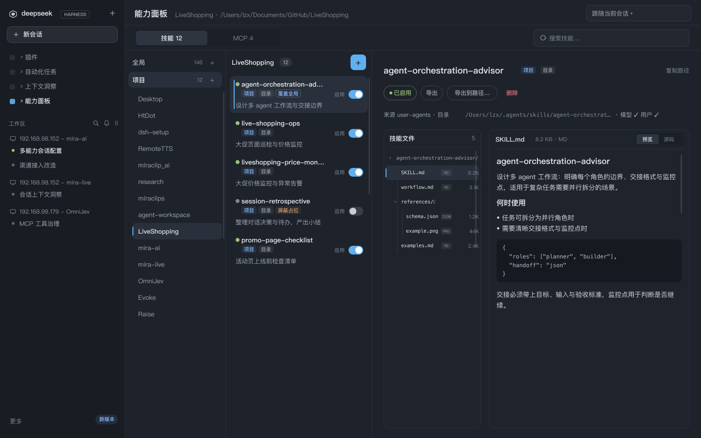
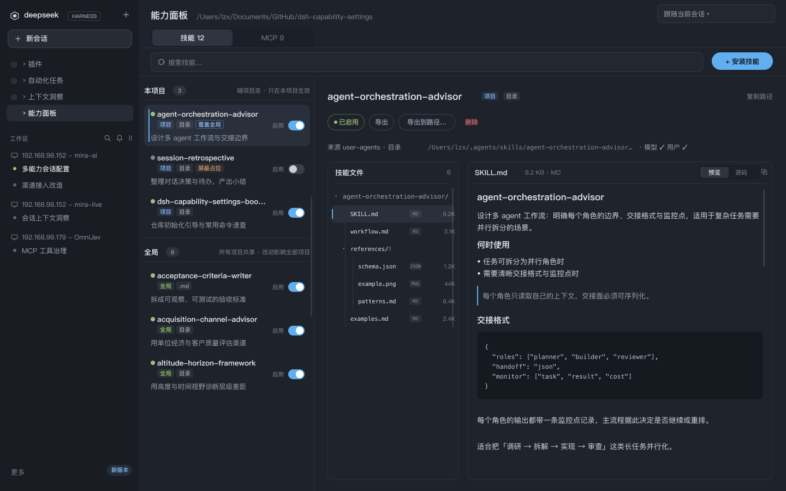
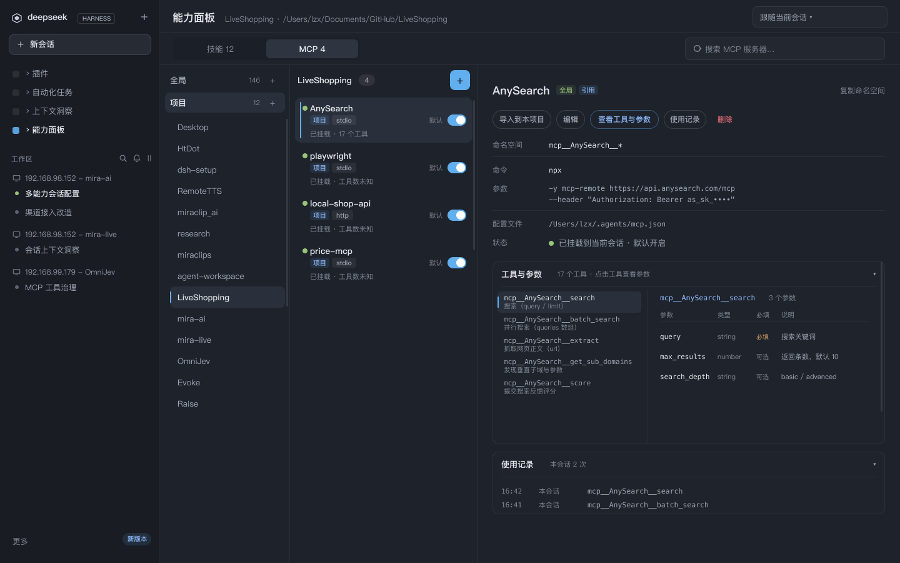
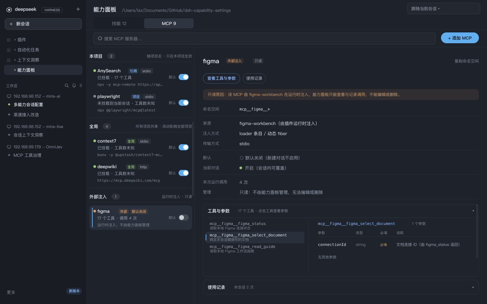

# dsh-capability-settings

一个 [DeepSeek Harness](https://github.com/deepseek-ai/deepseek-harness)（DSH）插件：
在 Web GUI 里**可视化管理项目的全部能力**——Skills、MCP 与插件工具（**Tools**），
覆盖**全局级 / 项目级（逐工作区）**双作用域。安装、启停、内容浏览与分发都能
**不离开浏览器**完成。

面板还内置 TypeSafe Jev「能力决策」：按当前输入草稿为**本会话**预选
Skills / MCP / Tools（Tools 以插件为单元），一次请求批量打 0–1 分，可手动点按，
也可按输入停顿自动触发（默认关闭）。会话首屏工具行另有**本会话能力入口**（书/插头/工具箱三域计数）与**配置弹窗**（背景模糊），并保留 `✦ 能力决策` 手动入口。



> **界面版本提示**：顶部截图是 **v7 预览**（工作区列表在左导航）；文中「技能详情」
> 「MCP 详情」两张仍是 **v6 预览（上一版）**——详情区在 v7 未改版式，仅中列/导航变化。
> **这些截图都不含第三个域 Tab「Jev 模型」与首屏「✦ 能力决策」**（v10/v11 新增），
> **也不含注入技能分组与来源标签**（v12 新增）；新界面见
> `docs/figma/preview/v11-*.png`（能力决策 5 帧）与并入 v12 的
> `docs/figma/preview/v8-01/02-*.png`、`v11-04-results.png`（v12 提案原图见 `v12-*.png`）。
> **v13 新增的第三域 Tools、首屏三域控制条、MCP 两枚来源标签、含 Tools 的能力决策**
> 见 `docs/figma/preview/v13-01…08-*.png`（Figma 页
> `Capability Panel · 全局开关与派生 v13`）。
> **v14 首屏入口（工具行 icon+计数）与配置弹窗**见 `docs/figma/preview/v14-01…04-*.png`
> （Figma 页 `Capability Dock · 首屏入口 v14`）；旧首屏截图仍是 v13 的"默认展开能力面板"版式。
> 当前 IA 说明见「一个面板，管住三个能力域」「注入技能」「Tools（插件工具）」
> 与 [docs/ux/panel-upgrade.md](docs/ux/panel-upgrade.md)、
> [docs/ux/capability-v13.md](docs/ux/capability-v13.md)（v1.8）。

> **外壳版本要求**：侧栏入口用的是 root 作用域的 `sidebar.panellist` 槽
> （「全局面板」图标排）与同 id 的 `main` keyed 槽，**需要 dsh 外壳 ≥ 0.2.0-rc.2**
> （桌面应用 0.2.0-rc.2 即有；更早的 `0.1.2-alpha.2` 只有 `sidebar.footer.action`，
> 那时入口与主区域面板都不会注册——升级外壳即可）。

## 它能做什么

| 能力域 | 浏览/搜索 | 新增/安装 | 编辑 | 启用/禁用 | 删除 | 导入/导出 |
|---|---|---|---|---|---|---|
| **Skills** | ✅ 左导航「全局 / 项目」+ 头部搜索 + 项目按工作区下钻 + 详情（目录树 + `SKILL.md` 阅读器，预览/源码） | ✅ 上传 / 宿主路径 / URL 三种来源 | ✅ | ✅ 行尾「启用」开关（项目区启停；全局 = 在本项目禁用/恢复）+ 详情页模型/用户方向独立开关 | ✅ 确认对话框 | ✅ 导入到本项目（物理副本）/ 在本项目禁用（屏蔽占位）/ 下载 zip / 复制到宿主目录 |
| **MCP** | ✅ 全局（含外部注入第二组）/ 项目按工作区下钻 + 实时挂载状态 + 行尾「默认」开关 + 工具与参数手风琴 | ✅ 表单新增（stdio/http）+ JSON 导入 | ✅ | ✅ 「默认」开关（新建对话）+ 当前对话开关（会话能力配置）+ 项目条目详情启停 | ✅ 两击确认 | ✅ 导入到本项目（引用，跟随全局）/ `.mcp.json` 与 Claude Code 格式兼容 |
| **Tools**（插件工具） | ✅ 插件列表 + 搜索（按插件名 / 工具名 / 工具说明）+ 详情**只读工具清单**（手风琴：参数表 + 原始 JSON，按需懒加载） | ❌ 由插件自带（插件注册即出现） | ❌ 工具清单只读 | ✅ **插件级**「启用」开关：**能力面板 = 全局默认**（所有会话）+ **会话首屏 = 本会话覆盖**；整插件全开 / 全关，无单工具开关 | ❌ | ❌ |

> 上表前两个是**条目域**（Skills / MCP，有配置文件与写入操作）；**Tools 是全局工具
> 注册视图**：只收「插件直接注册、且不是 `mcp__` 前缀」的工具，没有项目 / 工作区
> 维度、没有条目编辑 / 删除——一个插件就是一个开关单元。`mcp__*` 工具**恒归 MCP
> 域**，两域互斥、不重复收录。Tools 自己的开关分两层（能力面板 = **全局默认**、
> 会话首屏 = **本会话覆盖**，见下文）。面板另有第四个域 Tab **「Jev 模型」**：它
> 不是条目管理，而是 TypeSafe Jev 的全局配置页（无计数、无搜索、无左导航），并
> 驱动首屏 **「✦ 能力决策」**。详见下文「Tools（插件工具）」与「Jev 能力决策」。
>
> 表中「编辑 / 删除 / 导入」等写操作只作用于本插件**受管磁盘目录**下的技能；由宿主
> registry 注入的技能（DSH 内置 / 插件运行时 / Agent 预设渠道）**内容只读**，只能
> 「本项目默认 / 当前会话」启停，详见下文「注入技能」。

## 配置文件位置

本插件的配置文件**写入优先用 `.agents` 目录**，读取兼容旧位置与跨工具生态
（例外：Jev 能力决策配置、项目级「默认关闭」声明、会话级开关与 Tools 全局默认
统一存放在 dsh home 的插件目录，见下表）：

| 配置 | 写入目标 | 读取兼容（旧位置） |
|---|---|---|
| 项目级「默认关闭」声明（MCP 面板的「默认」开关 + 注入技能的「本项目启用」开关） | `<dshHome>/dsh-capability-settings/capability-overrides.json`（一个文件按**项目根**分 key：`projects.<项目根>.mcp` / `.skills`） | 旧项目内 `.agents/capability-overrides.json`（兼容 `.dsh` → `.claude`）：只读兼容，首次写入时把内容并入统一存储并删除旧文件 |
| 项目级「全局能力引用」声明（MCP 的「导入到本项目」） | `<项目根>/.agents/capability-imports.json` | — |
| 会话级能力开关（Skills / MCP / Tools 三域，按 sessionId） | `<dshHome>/dsh-capability-settings/session-capabilities.json`（`version: 1`，记录内 `skills` / `mcp` / `tools` 三个域） | — |
| Tools 归属扫描缓存（自动发现） | `<dshHome>/dsh-capability-settings/tool-attribution.json`（`version: 1`；包名+version+mtime+宿主版本失效；目录 `700` / 文件 `600`、原子写 + 锁；损坏自动重建） | — |
| Tools **全局默认**（能力面板 Tools 页开关；所有会话 / 新会话） | `<dshHome>/dsh-capability-settings/tools-global.json`（`{"version":1,"disabled":["<unit>",…]}`；目录 `700` / 文件 `600`、原子写 + 文件锁；缺省 = 全部启用） | — |
| 全局 MCP 服务器 | `~/.agents/mcp.json` | `~/.dsh` → `~/.claude` |
| Skills（项目/全局） | `.agents/skills`、`~/.agents/skills` | `.dsh/skills`（可写）、`.claude/skills`（只读展示） |
| 项目 MCP 服务器 | `<项目根>/.mcp.json`（Claude Code 标准，位置不变） | — |
| 快捷消息（**已下线**） | **不再读写** | 旧文件 `<项目根>/.agents/quick-messages.json`、`~/.agents/quick-messages.json`（以及旧位置 `.dsh` 同名文件）**原样保留**，不会自动删除；需要清理请手动处理 |
| Jev 能力决策配置（TypeSafe Jev） | `<dshHome>/dsh-capability-settings/jev.json`（默认 `~/.dsh/dsh-capability-settings/jev.json`；目录权限 `700`、文件权限 `600`） | 旧目录 `~/.dsh/capability-panel/jev.json` 首次读取时自动迁移（`rename`，幂等）；不读写 `~/.agents/jev.json` |

首次写入新位置时，旧文件内容会自动**并入并删除**（不丢配置、不留两份）。
`.agents` 与 `.dsh` 同时参与"项目根"判定（`.claude` 也纳入），换目录 / 换
工具搬家都不会影响配置归属。

## 亮点

### 🗂 一个面板，管住三个能力域

侧栏**上方**（品牌/新建会话行之下、工作区列表之上）新增「能力面板」入口，
点击后像「插件 / 自动化任务 / Context」那样**占据主区域**（不再是浮层，也不
会挤压对话区）。

**头部两行**：第一行 =「能力面板 · 当前工作区路径 · 项目作用域下拉」；
第二行 = **左侧域 Tab**（`Skills` / `MCP` / `Tools` / `Jev 模型`；前三个域带条目数量，
形如「Skills 12」「MCP 9」「Tools 6」，`Tools` 的分母是**插件数**；`Jev 模型` 无计数）
+ **右侧搜索框**（只在 `Skills` / `MCP` / `Tools` 显示，按域切换 placeholder）。
视图内不再有搜索/安装工具条——搜索与添加都收进头部与左导航。
点 **Jev 模型** 时：第一行的「工作区路径 / 项目作用域下拉」与第二行搜索框隐藏，
内容区为单列配置页（无左导航、无列表 / 详情）。
点 **Tools** 时：同样隐藏项目作用域与左导航（全局工具注册没有项目 / 工作区维度），
第一行显示 `全局工具注册 · 不区分项目 / 工作区` + 禁用态「全局工具 ▾」占位。

**左导航 = 全局 / 项目**：两行，行右侧各有一个「+」用于安装技能 / 添加 MCP
服务器（项目行在未选工作区时置灰，tooltip「先选择工作区」）。

- 左导航「项目」行下方**常驻列出全部工作区**（全局 / 项目两种 scope 都显示）——
  名称 = 文件夹 basename，`title` = 完整路径；点击即钉选该工作区，选中行高亮 +
  左侧蓝条。工作区多时列表在左导航内自身滚动；**没有「‹ 工作区」返回行**。
  **在「全局」scope 下点工作区会自动切回「项目」scope 并钉选**。
- 点 **全局**：中间列只列全局条目（`~/.agents/skills`、`~/.agents/mcp.json`）；
  MCP 还会在下方显示第二组「外部注入」（运行时注入的只读实例，组头带计数，
  为空时不占位）。左侧工作区列表此时仍保留，可直接切项目。
- 点 **项目**：中间列显示已钉选工作区的 `.mcp.json` / 项目技能；未钉选时只给一句
  「请选择左侧工作区」（工作区列表在左导航，不占中间列）。头部「项目作用域」下拉
  与左导航选择是**同一个状态**，两边同步。
- 默认进入「项目」scope；若还没选过工作区，中间列只给一句「请选择左侧工作区」。
- **切换工作区 / 刷新不闪加载**：已有数据时采用 stale-while-revalidate——列表与详情
  框架保留、后台静默重拉；只有首次进入（尚无数据）才显示「加载中…」。
- 搜索只过滤**当前可见列表**，不跨 scope：**未钉选工作区时（任意 scope）**过滤
  左导航工作区名/路径；已选工作区后左导航保持完整、只过滤中间列条目。技能全局列表
  的标题计数在搜索时显示「匹配/总数」。


> Jev 模型 Tab 与「✦ 能力决策」为 v10/v11 新增，上面这张 v7 截图不含它们；
> 新界面见 `docs/figma/preview/v11-05-config.png`（配置含能力决策）与
> `v11-01..04-*.png`（入口 / 停顿 / 评分中 / 结果）。

### 📥 Skills：三种方式安装，一键导出分享

- **浏览器上传**：拖入单个 `.md`、整个 skill 目录、或 `.zip` 压缩包
  （浏览器端 DecompressionStream 解压，零依赖）；路径防穿越，
  200 文件 / 20MB 上限。
- **宿主路径**：把磁盘上已有的 skill 目录或 `.md` 复制进受管根。
- **URL 下载**：GitHub 仓库（`https://github.com/<owner>/<repo>`，可带
  `/tree/<branch>/<子目录>`）、任意 `.zip`、raw `.md`
  （宿主端 30MB / 30s 限速）。

压缩包/仓库归档自动剥离公共顶层目录并定位唯一 `SKILL.md`；落盘名以
frontmatter 的 `name` 为准，同名冲突报错、可选覆盖。磁盘格式与官方
filesystem provider **逐字节兼容**（flat `<name>.md` / 目录型
`<name>/SKILL.md`），装完立刻可被 agent 调用。安装目标在安装对话框中选定
（「安装到本项目」/「安装到全局」，默认本项目；无工作区时只能装全局）。

导出同样简单：flat skill 直接下载 `.md`，目录型 skill 在浏览器端打成
store-only zip；也可以复制到宿主任意目录。

### ⚡ 行尾统一开关：一眼看清、一次点完

v2 把手写文字按钮全部收进详情，**列表每行右端只有一个开关**（30×18）：

- **技能行 =「启用」**：
  - 项目普通条目：开 = 模型与用户均可用；关 = 写入
    `user-invocable: false` + `disable-model-invocation: true`（一键禁用）；
  - 全局条目：开/关表达**本项目**是否禁用——关 = 生成屏蔽占位
    （shadow stub，只影响本项目；行标签显示 `本项目默认关闭`），开 = 删除占位恢复；
  - 项目屏蔽占位行：拨到开 = 恢复同名全局技能；
  - **未钉选项目（「跟随当前会话」）时也能开关**：写操作落在**当前会话的工作区**
    （`currentWorkspaceCwd()`），tooltip 会注明作用域；只有完全没有工作区时才置灰；
  - **置灰不可点**：只读来源（`.claude`）、全局条目已被项目副本遮蔽
    （`项目副本生效中`）、无可用工作区；tooltip 写明原因。
- **MCP 行 =「默认」**：开 = 新建对话默认启用，关 = 默认关闭（写项目级
  overrides 的 mcp 列表，语义与旧版一致）。外部注入实例同样有该开关
  （不可按项目屏蔽时置灰）。

点击开关**不改变选中**，写后就地静默刷新（失败回滚 + 详情错误条）。
列表圆点：技能**仅项目行**保留状态圆点（绿 = 双开、蓝 = 部分禁用、灰 = 全禁用、
空心 = 只读/屏蔽占位），全局行用关系标签表达；MCP 的行（含外部注入）都有圆点
（绿 = 已挂载 / 蓝 = 启用未挂载 / 橙 = 默认关闭或冲突 / 红 = 挂载失败 / 灰 = 禁用）。

详情页的动作区则保留完整操作：**状态按钮（已启用/已禁用/部分禁用）、
导出、导出到路径…、删除**；全局条目多出「安装到本项目」「在本项目禁用 /
恢复」；只读条目只保留导出与复制路径。**技能删除走确认对话框**（列出作用域
后果，`Esc` 可取消）；MCP 的删除/移出仍为两击确认。调用方式仍可**按方向
细调**：详情「调用方式」字段上「模型调用」与「用户调用」两个方向各自独立
开关（例如只允许 `/name` 手动触发、不让 agent 自动注入）。

### 📖 Skills 详情：目录树 + `SKILL.md` 阅读器

详情主区域拆成左树右阅读器（目录型技能；flat 单文件技能隐藏树、阅读器占满）：

- **目录树**：根目录行 `▾ <技能名>/` → 文件夹行（`/` + 文件计数，可展开/收起）
  → 文件行（类型徽标 `MD`/`JSON`/`PNG`… + 文件名 + 大小）。14px 层级缩进 +
  1px 引导线，`SKILL.md` 恒置顶并默认选中；点击任一文件 1 次即切换内容
  （一次拉全量后本地缓存，切换不再发请求）。
- **阅读器**：标题为当前文件名（+ 大小/类型），正文可切「预览 / 源码」——
  预览走**零依赖轻量 Markdown**（标题/列表/代码块/引用/分隔线/行内 code 与
  粗体；不解析内联 HTML、不加载外链图片、无 `dangerouslySetInnerHTML`），
  源码显示含 frontmatter 的原文。长文件只在阅读器内部滚动。
- **降级**：二进制文件给「无法预览」+ 下载；空文件给提示；单文件超过
  256 KB 只预览前 256 KB 并提示下载完整文件；目录最多展示 200 个文件、
  树深 3 层（超出截断并提示）。
- **数据通道**：复用既有 `skills.export`（它已递归返回目录下全部文件的
  相对路径 + base64），**没有新增宿主 RPC**；目录树与内容全部在客户端组树、
  解码与缓存。窄容器（内容区 < 632px）时目录树折叠为「文件 (N)」下拉，
  阅读器占满宽度。



### 🗃 Skills：全局 / 项目分离，项目级控制落实为真实文件

技能按来源分进「全局」与「项目」两个 scope（左导航切换；项目的工作区列表也挂在左导航
「项目」行下方），各自按真实文件列举——全局 = `~/.agents/skills` 等，项目 = 选中工作区的
`<项目>/.agents/skills` 等。
同名关系直接在行上标出，点击关系标签会切到另一 scope 并选中对应条目
（全局 → 项目时若还没选工作区，会尝试自动进入当前会话工作区）：

- 项目有同名副本 → 项目行 `覆盖全局`，全局行 `项目副本生效中`；
- 全局被本项目禁用 → 全局行 `本项目默认关闭`，项目组出现 `屏蔽占位` 行；
- 全局行一律没有圆点（全局技能对所有项目可见），状态由标签与开关表达；
- 「全局」作用域列表上方常驻说明 `启停仅作用于当前项目 · 其它项目不受影响`——
  这里的开关是**本项目默认**，不是"全局关闭所有项目"（见下文「三域默认层级对照」）。

**会话投影：本项目默认关闭 → 会话首屏默认关**

- 全局 Skills 被本项目**屏蔽占位**（shadow stub）关闭时，会话视图投影
  `enabledInSession=false`：**新会话首屏默认不启用**，与能力面板的
  「本项目默认关闭」一致；
- 会话内仍可**显式开启**（显式会话覆盖优先于项目默认，`true` / `false` /
  清除覆盖三态；清除后回到"本项目默认关"）；
- 被**项目副本**遮蔽的全局重复行会从**会话视图**过滤（同名只保留项目副本那行），
  首屏 / Jev 都不会出现同名两行，也不会把被遮蔽的全局行误报成"启用"。

项目级控制全部落实为项目区里的**真实文件**（副本或屏蔽占位），启停只写
skill 文件自己的 frontmatter，由宿主的文件 watcher + 目录重发布原生生效
（下一步即注入/剔除），没有写在插件私有配置里的叠层状态。

- **安装到本项目 / 导入到本项目**：把全局 skill（目录型连资源）**物理复制**
  到 `<项目>/.agents/skills`，此后在本项目对这份副本的一切控制都是项目级的；
  导入是**快照**，全局后续更新不会同步，项目内同名冲突可选覆盖；
- **在本项目禁用 / 恢复**（shadow stub 屏蔽占位）：在项目
  `.agents/skills` 生成同名占位文件（frontmatter 双向禁用 +
  `metadata: capability-panel: shadow-stub` 标记）。宿主按 frontmatter name
  合并技能、项目根 rank 恒高于全局根，占位文件于是**顶掉**同名全局条目——
  catalog 注入、`skill` 工具调用、`/name` 用户注入三条链路都在本项目内被
  宿主原生拒绝（其它项目不受影响）。删除占位即恢复；
- 提醒：**agent 侧的可见性以宿主 registry 为准**。要让某全局 skill 在本项目
  停掉 agent 自动触发，用「在本项目禁用」（整体屏蔽），或先导入到本项目、
  再在项目副本的详情里关闭「模型调用」（保留 `/name` 手动触发的细粒度控制）。

### 🧩 注入技能：来源展示、只读内容与本项目 / 本会话启停

宿主技能注册表（`ctx.get("skills")`）里还有一类模型实际能看到、但不在本插件
受管磁盘目录里的条目——由 DSH 随包、插件运行时或 Agent 预设渠道**注入**的技能。
面板现在把它们**只读**合并进列表：技能的「全局」scope 下多出 **「注入技能」分组**
（组头 `注入技能 · N · 内容只读 · 可启停`），按名称排序，同名时以磁盘条目为准。

每行带三类标签：

- **来源类别**：**内置**（DSH 随包，如 Office 技能）/ **插件**（插件运行时注册）/
  **预设**（Agent 预设渠道）；
- **格式**：目录 / `.md`；
- **渠道名**：`DSH 内置（Office）`、`dsh-to-figma`、`dsh-remote`、
  `插件运行时注入`，或 preset id（如 `cordis`；解析不出时显示「预设（未知）」）。

启停与只读语义（与磁盘技能**同逻辑、同开关位置**）：

- **面板行开关 = 本项目默认启停**：写统一存储
  `<dshHome>/dsh-capability-settings/capability-overrides.json` 里
  `projects.<项目根>.skills` 列表（与 `mcp` 列表并列、互不影响），新建对话按它
  决定该注入技能是否默认可用；只影响本项目。注入技能没有磁盘文件，所以
  **不写 frontmatter**，由插件在 `agent/created` 时按该名单在 agent 作用域注册
  同名 runtime shadow。
- **会话能力区 / 首屏 hero = 当前对话启停**：注入行与磁盘技能同列，开关调
  `skills.setSessionEnabled`，只作用于当前会话（**按会话落盘**，宿主重启 / resume
  后自动恢复；优先级 **显式会话覆盖 > 项目默认**）；冷会话（没有 live agent）时
  开关置灰。
- **内容只读**：注入技能没有可写的磁盘副本。详情页显示来源 / 渠道 + 只读原因条，
  隐藏 编辑、删除、导入、调用方向、导出到宿主路径等写操作（宿主侧对注入行的写
  RPC 同样返回 `read-only` 业务失败）；仍可查看正文、浏览
  `resourceBase.directory` 下的资源文件（按需读取，单文件 256 KB 上限；`../`、
  绝对路径、符号链接、非文本会返回明确错误）、导出为单文件 `.md` 正文快照
  （资源文件不打包，导出结果带 `lossy` 标记）。
- **冷会话看不到 preset 技能**：`预设` 渠道的技能由 preset 层 provider 提供，
  只有绑定该预设且有 live agent 的会话才可见（无 agent 时宿主 registry 无法选中
  preset 层）。冷会话因此只有 global 层注入（内置 / 插件）可见，Jev 评分集合也
  不含 preset 技能；会话开始后可重新评分。
- **降级路径**：宿主 registry 缺失 / 不可用 / 快照不完整时，面板**只显示磁盘
  技能**并提示一次，不弹异常、不影响磁盘读写；注入条目随 `skills/change` 刷新，
  插件卸载后不留死行。`resourceBase` 为 `url` / `opaque` 时详情只给正文并标注
  「资源在远端 / 不可浏览」。

> Figma 基线：v12 提案（注入技能来源）已**补丁式并入**面板终稿 v8 的技能·全局帧
> （`42:3433`：注入分组 / 5 个注入行 / 只读详情；`42:3376` 仅同步全局计数）与能力决策
> v11 的 04 结果帧（`56:7679`：决策行来源标签）；历史页面（v5/v6/v7/v9/v10 与 v12 提案页
> `88:8519`）保留不动。`docs/figma/preview/v8-01-skills-project.png`（152633 B）、
> `v8-02-skills-global.png`（165194 B）、`v11-04-results.png`（159880 B）已按新 UI 重导；
> 可重导入 scene 已同步：`v8-01`（264 节点）、`v8-02`（278）、`v11-04`（170），
> 重导方式见 `docs/figma/README.md` §3.1.3。
> **v7 及更早截图不含注入技能分组与来源标签**，仅作历史对照。

### 🧰 Tools（插件工具）：一个插件一个开关，全局注册无项目维度

插件除了挂 MCP server，还可以**直接向宿主工具注册表注册工具**（本机实例：
`dsh-univer-office` 的 `univer_*`、`dsh-remote` 的 `rw_*`、`@xmanrui/dsh-im` 的
`dsh_im_*`、`dsh-to-figma` 的 `figma_*`（0.2.3 起直接注册，不再走 `mcp__figma__*`）、
`dsh-better-sidebar` 的 `sidebar_open`、`dsh-popout-window` 的 `open_in_popout`、
`dsh-diff-approval` 的 `diff_approval_annotate` 等）。
这些工具此前只能"全部可见、无法按会话收起"；v13 把它们收进**第三个能力域 Tools**。

**域边界（两域互斥，按序判定）**

1. 工具名以 `mcp__` 开头 → **MCP 域**（永远是；插件自己注册的 `mcp__figma__*`
   也归 MCP，不进入 Tools）；
2. 命中宿主内建清单 → **不入任何域**（`bash` / `read` / `write` / `edit` / `glob` /
   `grep` / `web_search` / `skill` / `todo_write` / `present` / `subagent` /
   `workflow` / `ralph` / `create_worktree` / `list_mcp_resources` /
   `list_mcp_resource_templates` / `read_mcp_resource` / Agent Teams 工具组等；
   宿主不提供"危险等级"标注，这份清单由本插件自维护，**升级宿主版本后需复核**）；
3. 命中插件映射表 → Tools 插件单元；
4. 其余（非 mcp、非内建、无映射）→ 合并进唯一的 **「来源未识别」** 单元
   （`未识别` 琥珀标签；可开关、计入分母，但**不进 Jev 候选**——它可能混入未来
   宿主新增的内建工具，让模型去"推荐关闭"风险高）。

**归属自动发现（v14）：新增插件无需改表**

宿主工具注册表没有"哪个插件注入"的字段，所以按四层自动发现插件归属，
原硬编码映射表退化为**人工兜底与降级锚**（不再需要为新插件改表）：

1. **T0 运行时归属（调用方身份优先，主路径）**：tools 服务一可用就挂两个监听
   （早于第三方插件装载）——
   - `internal/get`：cordis 在服务解析点创建的 `Error` 栈第一帧就是**访问方
     插件**（`ctx.tools.register(...)` 里"读服务 → 注册"是同一段同步代码），
     配合 `ctx.fiber.name` 给出精确身份，**不受任何 `register` 包装影响**；
   - `tools/change`：同步取 `schemas()` 差集得到本次新增工具名，再用上一条
     身份配对；身份过期（异步/先存引用后注册）时退回注册栈兜底，取**最后一个**
     第三方帧（最靠近真实调用方）并跳过交叉校验识别出的拦截器包（置信度
     `medium`，UI 标「推测」）。
   帧路径先走「包根 realpath 前缀」映射（覆盖 `link:`/`@local/*` 的真实路径帧），
   再走 `node_modules/<pkg>`；丢弃宿主帧（`app.asar` / `@deepseek-ai/*`）与
   `dsh-mcp-client` bridge 帧；`mcp__*` 永不写工具归属（只从身份信号派生插件
   自注册命名空间）；零文件 IO、单次约 µs 级；连续失败 3 次自动禁用本进程 T0。
2. **T1 包扫描（冷启动回填）**：按插件包根扫源码字面量（只读 `.js/.mjs/.cjs`，
   跳 artifacts/test/`.d.ts`/node_modules，单文件/单包/总量限额）——工具名在
   **唯一**一个插件包里出现 → 归该包；多命中不猜（标 ambiguous）。
3. **T2 MCP 命名空间**：`mcp__<ns>__*` 的 `<ns>` 在唯一插件包内出现 → 该包
   （T0' 运行时命名空间优先）；`figma` 这类插件自注册命名空间不再依赖硬编码。
4. **T3 名字相似度（仅兜底）**：包名 token ∩ 工具名 token，score ≥0.5 且
   领先第二名 ≥0.3 才采用，标 `similarity` + **「推测」（琥珀）**，详情提示
   「来源为自动推测，关闭前请核对下方工具清单」；推测单元仍可开关。
   仍无法归属 → **「来源未识别」**（不猜，不进 Jev 候选）。

归属结果显示在 Tools / MCP 详情的「来源判定」：运行时捕获 / 包扫描 / 人工映射 /
名字推测 / 命名空间 / 未识别（运行时捕获带「高置信」= 调用方身份，「中置信 +
推测」= 注册栈兜底）；`tools.list.attributionSettling=true` 表示后台扫描未收敛
（列表不阻塞，前端可延迟静默刷新一次）。**已知边界**：本插件挂监听之前注册的
工具、异步注册（身份过期 → 注册栈兜底）、包根不可得、扫描超时/多命中 → 逐层降级，
最差等于改造前的「人工表 + 来源未识别」；`enableAutoAttribution: false` 可退回
纯人工表行为（不挂监听、不扫描、不写缓存）。

> **为什么不是纯栈归属**：平台上有插件会包装 `tools.register` 做自己的工具来源
> 标注（本机 `dsh-context` 即如此）。拦截器位于宿主 registry 与真实注册方之间，
> 旧版"取栈里第一个第三方帧"会稳定命中它——实测把 28 个别家插件的工具全判给
> `dsh-context`，且该单元的开关会连带 `tools.restrict` 掉这些真实工具。现在
> 身份信号来自 `internal/get`（服务解析点，不含拦截器），注册栈只做兜底。

**归属是启发式**：宿主工具注册表只有 `name / description / parameters`，**没有
"哪个插件注入"的字段**（`tools.register` 不接受来源参数），所以 Tools 按已知命名
约定归类（`univer_*` → `dsh-univer-office`、`rw_*` → `dsh-remote`、
`dsh_im_*` → `dsh-im`、`figma_*` → `dsh-to-figma`、`sidebar_open` →
`dsh-better-sidebar`、`open_in_popout` → `dsh-popout-window`、
`dsh-diff-approval-annotate` / `diff_approval_annotate` → `dsh-diff-approval`；
含基础工具名 `univer` / `figma` 的精确规则）。精确优先、同层最长前缀、
前缀必须以 `_` / `-` 结尾（`rwx_*` 不会被 `rw_` 误吃）。识别不到就归「来源未识别」，
**不猜成宿主内置**。

**开关单元 id = 完整包名，展示名去 scope**

- unit id（持久化键 `plugin:<unit>`）= **归一化完整 npm 包名**（含 scope，如
  `@xmanrui/dsh-im`）；卡片/详情展示名 = 包名去 scope（`dsh-im`），7 个已知插件
  展示名不变；
- **旧键迁移**：历史会话开关/全局默认里的旧 display 键在读取时自动归一
  （`dsh-im → @xmanrui/dsh-im`、`dsh-popout-window → @local/dsh-popout-window`；
  其余 5 个 id 不变），并**一次性写回 + 旧键镜像双写**（可回滚，保留到下一
  minor）：旧版插件读回时仍能找到开关；无法识别的键原样保留、绝不删除；
  迁移幂等、崩溃可续。

**两层语义：能力面板 = 全局默认，会话首屏 = 本会话覆盖**

- **能力面板 Tools 页 = 全局默认**（所有会话、含新建会话）：写
  `<dshHome>/dsh-capability-settings/tools-global.json`
  （`{"version":1,"disabled":["<unit>",…]}`；目录 `700` / 文件 `600`、原子写 + 文件锁）。
  改一次即**扇出到所有 live 会话**（宿主异步重算 restrict，不阻塞开关操作）；
  新会话在创建时按全局默认应用。
- **会话首屏 /「能力」Tab = 本会话覆盖**：写 `session-capabilities.json` 的
  `tools` 域（键 `plugin:<unit>`；按会话落盘、重启 / resume 恢复）。首屏行 3 的
  「全部开启 / 全部关闭」**只写本会话覆盖**、不动全局默认；底栏「恢复默认」清除
  本会话覆盖 → **回落到全局默认**。
- **生效值**：`effective = 会话覆盖 ?? 全局默认`。所以**全局关闭的插件，该会话仍可
  在首屏单独开启**（写会话覆盖 `true`）；全局开启时也可以单独关掉本会话。
- 一个插件 = 一个开关单元，**没有单工具开关**；`effective === false` 时在该 agent
  作用域调用 `tools.restrict({ deny: 该插件当前全部可继承工具名 })`，
  `effective === true` 时解除（disposer）。
- 持久化只存单元 id（`plugin:<插件展示名>`），**不存工具名**：插件升级增减工具后
  deny 名单自动跟随；两个文件都缺该键 = 跟随全局默认（全局默认缺省 = 开启）。
- 工具集会变（MCP 连上、插件懒加载）：监听 `tools/change` 后微任务合并重算，
  deny 名单与上一代等价时直接短路（`restrict` 自身也会触发 `tools/change`，
  短路是刷新不形成循环的关键）。
- **降级**：旧外壳 / 环境没有 `tools.restrict` → `tools.list` 提前返回
  `lockedReason`，开关从一开始就置灰；名单为空（工具尚未注册）→ 不调用 restrict、
  状态记 `skipped`；restrict 抛错 → 状态 `failed` + warning，**不阻断**其它开关
  和另两域。工具注册表读不到 / 抛错 → Tools 页空态 + 说明，Skills / MCP 不受影响。
  `tools-global.json` 缺失 / 损坏 / 未知 version → 按"全部启用"降级并 warning；
  已卸载插件残留的 unit id 读取时忽略（不删文件里的用户数据）。
- **注册在 agent 自身层的插件工具不会出现**：`tools.restrict` 只能过滤"继承层"，
  自身层工具既枚举不到也关不掉，所以 Tools 里**不显示**（不是显示后置灰）——
  这是相对早期交互稿的规格修正，避免给出一个"永远点不动"的开关。

**面板 Tools 页（两栏、无左导航）**

中列 = 插件行（插件名 + `插件` / `未识别` 标签 + `N 个工具` + 「启用」开关：
**能力面板的开关 = 全局默认**，不需要当前会话，也不显示任何具体会话状态）；
右侧详情（**整页纵向可滚动**，工具多时不会撑破布局）= 标题（插件名 + 两枚标签）+
`复制插件名` + `来源判定`（如 `前缀 univer_ → dsh-univer-office（插件清单映射表）`）+
`注入方式：插件运行时注册的非 MCP 工具（不落盘）` + 工具数 + **工具清单**：

- 手风琴（一次展开一个）：每行 = 工具名 + `N 个参数 / 无参数`；展开显示该工具的
  一句话说明、**参数表**（参数 / 类型 / 必填 / 说明；`enum` 显示可选值）与
  **可折叠的原始 JSON**（`parameters` 原文，等宽、横向可滚、自身纵向限高）；
  无逐工具开关；
- **schema 按需懒加载**：`tools.list` 只回 `name` + 200 码点说明（不带
  `parameters`，首屏请求保持轻量），只有打开详情、选中插件时才调
  `tools.inspect {unit}` 拉完整定义并按 plugin 缓存；读取失败降级为「仅名称 +
  说明」并提示参数不可用；
- **开关只在左侧列表行**：详情不再重复「默认开关 / 状态」行（同一个全局默认开关
  只出现一次）；对话首屏的 Tools 卡片在该插件存在**本会话显式覆盖**时会多一枚
  `本会话覆盖` 蓝标签（悬停说明 `全局默认开启/关闭；本会话单独设置`），用于解释
  「能力面板显示全局默认关、本会话却开着」；
- 交付字段：`tools.list` 每单元有 `defaultEnabled`（全局默认）、`enabled`
  （本会话生效值；`enabledInSession` 为等名 legacy 别名）与 `explicit`
  （本会话是否有显式覆盖，供 UI 显示上面的 `本会话覆盖` 标签）；能力面板写
  `tools.setGlobalEnabled`，会话首屏写 `tools.setSessionEnabled`，两者互不影响。

### 🔌 MCP：改配置即热挂载，不重启、不改 preset

- 配置文件与 **Claude Code 的 `.mcp.json` 格式兼容**：项目级
  `<projectRoot>/.mcp.json`，全局级 `~/.agents/mcp.json`（读取兼容旧位置
  `~/.dsh/mcp.json`），同名 key 项目级覆盖全局级；`env`/`headers`/`args`
  支持 `${VAR}` 环境变量插值。
- **用途描述与凭据掩码**：新增/编辑弹窗新增「用途描述（可选，供 Jev 能力判断）」，
  存条目 `description` 扩展字段（Claude Code 形状之外；详情页展示）。MCP 列表摘要、
  详情里的参数 / URL 展示，以及发给 Jev 的能力描述统一做凭据掩码
  （`--header` / `--api-key` / `-H` 的下一个参数，Bearer / Basic / `KEY=value` /
  URL query / 常见 token 前缀 → `***`），不会把 `mcp-remote … --header "Bearer …"`
  直接展示或外发。
- 列表按**左导航 scope** 组织：**全局**（`~/.agents/mcp.json`；可导入到本项目 =
  登记引用、编辑、删除）+ 下方第二组**外部注入**（运行时由其它插件/profile
  挂载的实例，只读，仅在该组非空时出现）；**项目**（先选工作区，显示该工作区
  `.mcp.json`，可启停/编辑/删除）。左导航工作区列表在两种 scope 都常驻，全局态点
  工作区会自动切回项目并钉选。
- 列表行的 **hover / 选中底色覆盖整行**（含右侧「默认」开关），不是只覆盖左侧卡片。
- 全局级 `<agentsHome>/mcp.json` 的条目**整个 harness 只挂一份实例**（挂在
  本插件自己的 Cordis context 上，`serverName` 按 root 作用域预留，各 session
  共用同一个 MCP 进程）；**项目级** `<项目根>/.mcp.json` 的条目仍挂在 agent
  自己的 Cordis context 上——工具以 `mcp__<serverName>__<tool>` 出现在**该
  session 内**，同一工作区里各 session 各一份、彼此隔离，agent 销毁自动卸载。
- **「工具与参数」是手风琴**：每个工具一行，只显示**工具名 + 参数个数**（不显示
  description）；点工具名在**该行下方**展开参数表（**参数 / 类型 / 必填 / 说明**，
  来自该工具 `inputSchema` 的 `properties` 与 `required`），再点收起；**同一时间
  只展开一个**，默认全部收起，展开/收起不会重新探测。配置条目由「查看工具与参数」
  真连一次（零副作用，`finally` 关闭、不注册工具、不留子进程）；**外部注入实例**
  直接用运行时注册表里的工具与参数渲染同一套手风琴，不需要重连。新增/编辑弹窗里的
  「测试连接」仍会列出工具与参数，与详情面板同一数据源。手风琴是单列宽度自适应，
  窄容器下不会出现工具列表被压成细条；工具行鼠标点击不显示焦点环，键盘聚焦用内描边。
- **MCP 有「默认开关」和「当前对话开关」两级**：
  - 面板 MCP 列表每行右端是**「默认」**开关（配置条目与外部注入实例都有）：
    写项目级"默认关闭"声明，**新建对话按它来**；已有对话在没有任何手动覆盖时
    也跟随它。外部实例同样适用（默认关闭只是"新建对话默认不启用"；按会话
    作用域注入的实例无法屏蔽，开关置灰）。
  - **当前对话开关**在会话内能力配置（首屏工具行入口的配置弹窗 / 顶部「能力」Tab）里：
    只影响当前对话、**按会话落盘**（宿主重启 / resume 后自动恢复）；项目条目
    按需挂载/卸载，全局与外部实例用 `tools.restrict` 屏蔽/恢复其工具。显式
    会话开关优先于默认。
  - 行尾「默认」**不是启停**：配置条目的启用/禁用在该条目的详情状态按钮与
    编辑表单里。
- **外部注入的 MCP 也能管理（只读 + 默认/当前对话开关）**：其它插件或 profile
  在运行时挂载 / 注册的 MCP 出现在全局 scope 的第二组「外部注入」。识别覆盖**两种
  存在形态**：
  1. **mcp-client 实例**：cordis 动态 fiber 或 loader 条目（profile
     `cordis.patch.yml` 的 `insert:`）挂的实例，来源 = `Fiber.name` / 条目 id；
  2. **插件自注册的工具命名空间**：插件直接 `ctx.tools.register` 注册
     `mcp__<ns>__*`、**没有** mcp-client 实例（本机 `dsh-to-figma` 的
     `figma`）。这类从全局工具视图反推，合成一条 `origin:"namespace"` 的行
     （`synthesized`，无配置；详情注明「工具命名空间合成（不落盘、无 mcp-client
     实例）」）。
- **来源用两枚标签表达**（与 Skill 的「插件 + 渠道名」同形）：有插件展示名 →
  `插件` 紫标签 + 插件名小标签（如 `dsh-to-figma`，超宽省略、悬停全名）；
  命名空间合成但映射表未覆盖 → 只给 `未识别` 琥珀标签；其余 → 只给 `外部注入`。
  列表行的名称行**只放状态点 + `serverName`**，来源两枚标签放在下方 meta 行——
  两枚标签不再把名称挤没（`figma` 这类合成行现在能直接看到名称）。
  详情新增「来源判定」（`前缀 mcp__figma__ → dsh-to-figma（插件清单映射表）` /
  `运行时注入来源：{source} → {channel}` / `来源未识别（不是宿主内置）`）与
  「注入方式」；组内排序 = 有插件名的按展示名升序、无插件名的排后面。真实例优先
  于命名空间合成行（同名只出一条，`origin` 保持 `entry` / `fiber`）。
- 详情给出只读原因提示条与字段（命名空间、来源、注入方式、传输方式、默认 / 当前
  对话、本次运行调用、管理说明），并可查看工具与参数、使用记录。它们
  **不可编辑/删除/卸载**（配置与生命周期在注入方）。
- 详情还有**「使用记录」**（只读、不落盘）：列出最近的调用——什么时候、哪个
  session（显示侧栏的会话标题，拿不到标题时显示会话 id 尾部）、调用了这个
  server 的哪个 tool；默认显示最近 50 条（宿主内存里最多留 200 条），打开期间
  每 2s 静默刷新。实现是宿主侧一个**全局 `tools.guard` 旁路**：只观察
  `mcp__<serverName>__<tool>` 调用、**永远放行**、异常吞掉，不写任何文件、
  不影响工具执行；插件重载或应用重启即清空。记录的是**调用尝试**（执行前），
  不代表该次调用成功。
- 面板里每次新增/编辑/删除/启停，都会**自动重挂受影响 session** 的 MCP 连接；
  但**写入不必等重挂**——RPC 只等配置文件落盘就返回，列表立刻刷新（删除/新增/
  启停都即时可见），重挂在后台按队列进行：重挂期间还没拿到状态的条目显示
  「挂载中…」，面板静默轮询直到挂载状态收敛，且不会闪「加载中…」。





### 🎯 项目级控制全局能力

全局能力默认对所有项目生效。想只在某个项目里调整，各域都有落在真实文件/声明
上的机制（都不写插件私有的叠层状态）：

- **Skills**：「导入到本项目」物理复制出项目副本（此后项目内独立启停 /
  细调方向，快照不跟随全局）；或「在本项目禁用」生成屏蔽占位（shadow stub，
  整体屏蔽，删除即恢复）；
- **MCP**：「导入到本项目」登记**引用**（内容实时跟随全局，启停是引用上的
  项目级标记，写在 `.agents/capability-imports.json`）；全局条目的行尾
  「默认」开关写统一存储 `capability-overrides.json` 的 `projects.<项目根>.mcp`
  列表，决定新建对话是否默认启用；
- **全局实例的「关掉」靠 `tools.restrict`**：全局 MCP 实例是共享的、无法按
  项目卸载，所以按 session 在该 agent 作用域上 deny 掉
  `mcp__<serverName>__*`——全局配置不动、其他项目不受影响；宿主不提供
  `restrict` 时降级（记 warning + 状态标 `skipped`，工具对本会话仍可见）；
- **Tools 没有项目级维度，但有「全局默认 + 会话覆盖」两层**：Tools 是全局工具
  注册，插件工具与项目 / 工作区无关，因此**不写** `capability-overrides.json`；
  能力面板 Tools 页写全局默认（`tools-global.json`，所有会话），会话首屏写本会话
  覆盖（`session-capabilities.json` 的 `tools` 域）。「恢复默认」= 清除本会话
  覆盖 → 回落到全局默认。这样既保留"同一插件在所有项目行为一致"，又允许单会话
  偏离（全局关闭时该会话仍可单独开启）。

**三域「默认」层级对照**（三个域的"默认"不是同一层，别混读）：

| 域 | 能力面板开关 = | 作用范围 | 会话首屏 |
|---|---|---|---|
| **Skills** | **本项目默认**（项目区启停；全局条目 = 在本项目禁用 / 恢复，写 shadow stub） | 仅当前项目，其它项目不受影响 | **本会话覆盖**（显式 > 项目默认）；项目默认关闭时首屏默认关，可会话内临时开 |
| **MCP** | **本项目默认**（行尾「默认」开关写 `capability-overrides.json`；全局实例按项目 / 会话关闭走 `tools.restrict`） | 仅当前项目 | **本会话覆盖**（显式 > 项目默认） |
| **Tools** | **全局默认**（`tools-global.json`，所有项目 / 所有会话共享） | **所有**项目与所有会话 | **本会话覆盖**（显式 > 全局默认；全局默认关时仍可本会话单独开） |

> **Skills 没有「全局关闭所有项目」的开关**：面板里所有启停都只落在**当前项目**
> （项目副本的 frontmatter，或屏蔽占位 stub）。要让某个 Skills 对所有项目都不
> 可用，只能删除 / 修改技能本身，或让其来源（`.claude` 只读根、注入方）整体
> 禁用——插件不提供第二层"全局默认"。MCP 同理没有"全局关闭"：全局实例共享，
> 按项目 / 会话关闭是用 `tools.restrict` 屏蔽工具，不改全局配置文件。
> Tools 是唯一有"全局默认"这一层的域（能力面板写所有会话共用的默认）。

### 🎛️ 会话能力配置：首屏入口 + 配置弹窗 + 顶部「能力」Tab

会话能力（Skills / MCP / Tools）的查看与开关分两个入口，**这里的开关只作用于
当前会话、按会话落盘**（`<dshHome>/dsh-capability-settings/session-capabilities.json`；
宿主重启 / resume 后恢复；Tools 的全局默认在能力面板设置，不在这里），优先级
`显式会话覆盖 > 项目默认 > 配置 disabled`；**Tools 的两层是「会话覆盖 > 全局默认」**
（全局默认存 `tools-global.json`、所有会话共享，缺省全部启用）。
输入框工具栏的快捷按钮与输入框下方独立能力条已按产品决定移除：

- **首屏（hero）默认收起，入口收进工具行**：注册在 `conversation.input.left`
  （输入框底部工具行里、`工作区内修改` 之后的预留位）。收起态只有
  `书 + Skills 数` / `插头 + MCP 数` / `工具箱 + Tools 数` 三枚单色 icon + 计数
  （计数 = 已启用数，tooltip 显示 `已启用 / 总数`）、分隔线、`✦ 能力决策` 与
  滑杆「配置」。**点哪个域的 icon 就打开对应 Tab**（Skills / MCP / Tools），
  滑杆「配置」沿用上次停留的 Tab；点击后是 **居中弹窗**：`55%` 遮罩 + `10px`
  背景模糊，宽 1120、高随域自适应；Esc / 点遮罩 / ✕ / 完成关闭，Tab 焦点圈定在弹窗内。
  弹窗内容复用能力面板（三 Tab + 搜索 + 行 3 控制条 + 卡片网格 + 恢复默认），
  不再有「点击整条 → 内联下拉展开」的旧交互。仅 hero 相位渲染；active 相位入口
  隐藏（改用顶部「能力」Tab）。
- **会话中：顶部「能力」Tab**（`conversation.view`，与「对话 / 轨迹 /
  上下文 / 编队」同级）：整页管理本会话能力，**三 Tab `Skills` / `MCP` / `Tools`**
  （`Tools` 计数按插件数），卡片网格自适应列数、搜索、行 3 控制条、`恢复默认`。
  进入该 Tab 时会临时隐藏输入框（只做能力管理、不需要对话输入），切回其它 Tab
  自动恢复。
- **行 3「本会话控制条」（v13 新增）**：`全部开启` / `全部关闭` + `已启用 n / m`
  （m = 三域可开关单元总数，Skills 条数 + MCP 行数 + Tools 插件单元数）+
  `仅当前会话 · 不改项目默认`；作用范围 = `Skills · MCP · Tools` **三域整体**
  （不按模块分）。批量**只写本会话覆盖**：不改 `capability-overrides.json`，也
  **不改 Tools 的全局默认**（`tools-global.json`）；Tools 的「全部开启」会把全局
  默认关闭的插件也在**本会话**打开（会话覆盖优先）。**无二次确认、无提醒条**：
  点一下直接生效；全开 / 全关时对应按钮禁用（tooltip「已全部开启 / 已全部关闭」）；
  执行中按钮变
  `全部开启中… / 全部关闭中…` 并显示域级进度（`正在关闭 2 / 3 个域…`）；部分失败
  显示 `n 项失败 · 重试`，点重试**只重放失败所在域**。
- **卡片来源标签完整显示**：注入技能卡片底部是「来源类别 + 渠道名」两个小标签，
  渠道名按内容自适应宽度（`DSH 内置（Office）`、`DSH 内置（随包技能目录）`、
  `dsh-diff-approval` 等不再被固定的 92px 上限截成 `DSH 内置（Offi…`）；卡片
  过窄时渠道名整体换行到第二行显示全文，只有极窄容器才收缩省略，完整渠道名同时
  作为 `title`（悬停可读）。与 Figma v12 的标签设计一致（设计稿标签宽度即按文本
  自适应）。

语义（全部会话级）：

- **MCP（服务器级）**：项目条目按需挂载/卸载；global / 外部实例用
  `tools.restrict` 屏蔽/恢复工具，不卸载共享实例；即上文「当前对话开关」。
  写后宿主异步重挂，面板用 `settling` 800ms × 20 静默轮询收敛。
- **Skills（关闭 / 恢复）**：宿主注册表没有按会话禁用 API，本插件在**该
  agent 作用域**注册同名 runtime skill shadow（`invocation` 双向 false），
  使该 skill 从「模型目录 / `skill` 工具 / `/name` 用户口令」三条链路消失；
  恢复即解除 shadow。**只可关闭、不能强制开启文件级已禁用项**；会话没有
  live agent 时开关置灰。**项目默认关闭的投影**：被本项目屏蔽占位关闭的全局
  Skills 在会话首屏默认 `enabledInSession=false`（新会话默认关），会话内仍可
  显式开启（显式覆盖优先于项目默认）。
- **Tools（插件级，两层）**：首屏开关写**本会话覆盖**（`session-capabilities.json`
  的 `tools` 域），只影响当前会话；`effective = 会话覆盖 ?? 全局默认`，当
  `effective === false` 时对该插件的全部可继承工具 `tools.restrict`（deny 名单
  每次重算，持久化只存插件单元 id），共享实例不卸载，插件升级增减工具自动跟随。
  全局默认关闭的插件**仍可在本会话单独开启**；`lockedReason` 的单元开关置灰；
  冷会话（无 live agent）仍可落盘，agent 创建后按 effective 重算 restrict。
  「来源未识别」单元同样可开关、计入分母，但**不进 Jev 候选**。
- **批量语义（`session.setBulk`）**：宿主自己枚举三域目标、**幂等**（重放只写差异）、
  **同会话串行**、**部分失败不回滚**（失败项在 `failed[]` 里带
  `domain / target / kind / error`，已成功项保留；重试 = 重放同一 action）；
  冷会话时 Skills 项跳过（需要 live agent），MCP / Tools 仍落盘。
  **批量只写会话覆盖、不写任何全局默认**（Tools 全局默认只能从能力面板改）；
  `reset` 清除本会话覆盖，Tools 回落到全局默认。
- RPC：`skills.sessionList`（磁盘列表 + `enabledInSession` /
  `canToggleInSession`）、`skills.setSessionEnabled`；`mcp.list` 带上
  `sessionId` 后由宿主投影 `enabledInSession`；`tools.list`（每单元
  `defaultEnabled` 全局默认 + `enabled` 本会话生效；`enabledInSession` 为等名
  legacy 别名）、`tools.setSessionEnabled`（会话覆盖，batch-first）、
  `tools.setGlobalEnabled`（全局默认，写 `tools-global.json` + 扇出所有会话）、
  `tools.inspect {unit}`（懒加载工具 schema / `parameters`）；三域一键开 / 关 /
  `恢复默认` 走 `session.setBulk`（`reset` = 只清显式会话覆盖；Skills / MCP 回项目
  默认，Tools 回全局默认）。
- **持久化与清理**：会话开关按 sessionId 落盘，切换会话 / 刷新页面 / 宿主重启 /
  resume 后都保持；写入失败只记 warning（本次运行内仍生效）。会话被删除后，插件
  按「存在性校验 + 24 小时两阶段」清理其记录——宿主没有会话删除事件，关机时的
  `session/disposed` 只做缺失标记、**绝不直接删除**，避免重启清空全部会话开关。
  `fork` 出的子会话是新 id，不继承父会话的会话级开关。

> **⚠️ 派生继承（R2）本版未实现**：`继承 / 不继承` 布尔开关（subagent / teammate
> 共用、三域整体、默认继承）目前**只有交互设计**
> （[docs/ux/capability-v13.md](docs/ux/capability-v13.md) §4），代码、持久化字段
> 与 RPC 都未落地——首屏行 3 右侧**不渲染任何继承控件或弱提示**。派生 agent 的
> 能力仍按现有规则（项目默认 / 项目级声明）取得，**不是**「跟随父会话生效集合」；
> 不要把设计稿的默认「继承」当成现状。

### 🧭 Jev 能力决策：按输入草稿为本会话预选能力

面板第四个域 Tab「Jev 模型」是 TypeSafe Jev 的全局配置页；配置完成后，新会话首屏
（hero）出现「✦ 能力决策」入口，按当前输入框草稿给本会话 **Skills / MCP / Tools**
打 0–1 分（**Tools 以插件为一个单元**，不按单个工具打分），勾选后只写成**当前会话**
的能力开关。

**配置（全局，所有项目 / 会话共享）**

- 字段：Base URL（默认 `https://api.typesafe.ai`）、模型名（默认 `jev-latest`）、
  API Key 来源（`直接填写` / `环境变量`，默认变量名 `TYPESAFE_API_KEY`）、测试连接、
  保存、恢复默认（需行内再点一次确认，只重置表单）。保存成功**不关闭配置页、不跳转**。
- **页头说明（v13 文案收口）**：不再有独立 callout（原先的说明块——一次请求 / 隐私
  口径、密钥路径 `~/.dsh/...` 与 `目录 700 / 文件 600`——已整段删除）；说明并入
  标题下**副标题两行**，密钥安全承诺收进 **API Key 标签右侧 `ⓘ`**
  （`密钥仅存宿主，不下发浏览器`）。「能力决策」区内的成本提示与自动触发隐私说明
  保留，其余字段与语义不变。
- 密钥与路径（**配置落点事实，界面不再展示**）：配置保存到宿主
  `<dshHome>/dsh-capability-settings/jev.json`（默认
  `~/.dsh/dsh-capability-settings/jev.json`；`DSH_HOME` 存在时以其为根；目录 `700` /
  文件 `600` 的权限不变）。宿主解析密钥的优先级是
  **环境变量（`apiKeyEnv`）> 配置文件中的 key**；界面只显示来源与末 4 位
  （短 key 显示 `****`），浏览器 / RPC 响应都拿不到明文。
- 保存后无需刷新页面：下一次评分 / 测试立即使用新配置；首屏 hero 监听配置变更事件，
  并在窗口重新聚焦时重读配置。
- 「能力决策」区：`输入停顿后自动评分`（默认**关闭**）、停顿阈值（默认 `1000 ms`，
  `300–3000`、步长 `100`）、最少触发字数（默认 `10`，`1–200`）、
  最少修改间隔字符数（默认 `4`，`1–100`）；常驻成本提示与隐私说明。

**手动触发**

- 首屏工具行能力入口里的「✦ 能力决策」按钮；点击即评分，
  不依赖自动触发开关。草稿为空时按钮禁用；未配置 Jev 时按钮可点并带蓝点，点击
  跳到「Jev 模型」Tab 配置。
- 结果面板出现在输入卡下方（同宽、不遮输入框、不抢焦点），仅保留标题 / 模型徽标 /
  阈值滑杆 / 结果列表：分数降序（**同分按三档全序 Skills → MCP → Tools**，再按名称）；
  阈值滑杆 `0–1` 步长 `0.05`、默认 `0.50`，分数 ≥ 阈值预勾选；可手改勾选；显示
  `已选 n / N`（N = 全部参与评分的 Skills + MCP + **Tools 插件单元**，含不可切换项；
  「来源未识别」单元不参与）；底栏「重新评分 / 取消 / 应用所选（n）」。
- **Tools 结果行（插件级）**：插件名（等宽字体）+ `插件` 标签 + `N 个工具` 标签 +
  描述（优先取插件 `package.json.description`，读不到时回退 `N 个工具 · 插件注入`）+
  分数条；**不逐工具出行、不挂来源小标签**（名称即插件名，避免重复）；列表下方补一行说明：
  `Tools 以插件整体计分与启用：选中即开启该插件全部工具；Jev 只收窄，不重新打开已关闭的能力。`
- **注入技能参与评分与应用**：会话 `skills.sessionList` 含内置 / 插件 / preset 注入
  行后，Jev 枚举自动纳入它们（id 仍是 `skill:<name>`，应用写会话开关，逻辑与磁盘
  技能一致）。结果行在能力名旁显示来源小标签（**内置** / **插件** / **预设渠道**，
  取自宿主 additive 字段 `origin` / `channel`）；旧宿主没有这些字段时按原样不显示。
  冷会话评分集合**不含** preset 技能（无 live agent 选不中 preset 层），会话开始后
  可重新评分。
- **Tools 参与评分与应用（插件级，按本会话 effective）**：候选 = **本会话生效
  （`enabled === true`）** 的已识别插件单元（`dsh-univer-office` / `dsh-remote` /
  `dsh-im` / `dsh-better-sidebar` / `dsh-popout-window` / `dsh-diff-approval` 等），
  `name` = 插件展示名、描述 = 插件 `package.json.description`（读不到回退
  `N 个工具 · 插件注入`）；请求带**工具名 + 一句话说明**：前 8 个带描述（命名上限
  8 个 / 描述 ≤120 码点 / 总 500 码点），其余工具名放进 `moreTools`（最多 24 个 /
  总 600 码点）；**不带参数 schema**、不带工具逐个开关。
  全局默认关闭 / 本会话已关的插件**不进候选**，因此 Jev 不能把它们重新打开
  （只收窄不扩权）；「来源未识别」单元不进候选。旧宿主 / 未注入 `tools` 服务时
  枚举跳过 Tools 段（warn 一次），Skills / MCP 照常评分。
- **MCP / 插件描述（P0+P1）**：MCP 配置项支持可选的 `description`「用途描述」
  （编辑弹窗可填，优先使用）；未填时从 `command/args/url` 推导（远程 host / npm
  包名 / 脚本名 / 命令名），不再把原始命令行当描述。MCP 摘要与参数展示、Jev 请求体
  统一做凭据掩码（`--header` / `--api-key` / Bearer / Basic / `KEY=value` / URL
  query），本机 `mcp-remote … --header "Bearer …"` 不会再外发。
- 评分请求**一次**发给 `POST {Base URL}/v1/systemone`：每个能力一条 `noul`，一个
  0–1 分；**不分片、不按能力拆请求**。单次最多 300 个能力（超出直接报错不请求）；
  请求体超过 150k 字符时按 4 档降级（先减 `moreTools`、再丢工具清单、最后完全不带
  工具）；超上下文返回「输入内容超出模型上下文上限」，不自动截断或分批。
- 缺分 / 非数值答案按容错处理：数值 clamp 到 `[0,1]`（`1.2`→`1`），缺失 / 字符串 /
  `NaN` → 该能力 0 分并标注「未获得评分」（`reason=no-answer`），**不整单失败**，
  列表不丢行。
- 「应用所选」按**筛选语义**只写**当前会话**的会话开关：勾选 → 启用，未勾选的
  可应用能力 → 关闭（技能关闭 / 恢复，MCP 按会话屏蔽 / 恢复，**Tools 整插件开 / 关**；
  不可应用项不动），不改项目默认。**只收窄不扩权**：已关闭的能力不会被 Jev 重新
  打开（未选中且已关闭 = 状态一致，进 `already-applied`）。成功 toast 显示「启用 X
  项、关闭 Y 项（仅当前会话）」，重复应用只写差异；冷会话排队完整 ops（含关闭），
  提示「已加入本会话，发送首条消息后生效（启用 X · 关闭 Y）」；失败尽力按前态回滚
  （启用 / 关闭均恢复，含 Tools 的显式覆盖前态）。未勾选任何能力时也可直接应用
  （按钮「应用（关闭全部）」），等于关闭本会话全部可应用能力。应用为批量写入
  （skills 同 tick、MCP 并发 ≤4、Tools 并发 ≤4），通常 <1s；实际耗时取决于本会话
  能力数与宿主状态。

**输入停顿自动触发（默认关闭）**

- 开启后，仅在 hero 相位、Jev 已配置、无评分 / 应用进行中，且同时满足两个门槛时，
  停止输入达到「停顿阈值」即自动发起 1 次评分并展开面板：
  - 草稿字符数（`trim` 后按 Unicode 码点）≥ 最少触发字数；
  - 自上次能力决策以来累计编辑字符数（**插入 + 删除**）≥ 最少修改间隔字符数。
- 编辑量在**任意一次能力决策触发后、草稿清空后、发送首条消息后**归零；每次草稿变化
  都重置停顿计时，但**不清零**编辑量。等待期间**不显示倒计时文案**（原先能力条 /
  面板标题行的「停顿 0.9s / 1.0s · 即将能力决策」弱提示已移除，避免首屏多一行常驻
  文本）；停顿到点直接发起评分，不弹 toast、不抢焦点；取消评分后同一草稿保持静默，
  直到再次累计到最少修改量。
- 关闭开关（默认）时不会自动请求，入口仍可手动触发；会话进行中（首条消息后）
  不再自动触发。

**冷会话与错误 / 隐私边界**

- 首屏还没有 live agent 时，应用走**排队生效**：chips 立即回显 + 提示
  「已加入本会话，发送首条消息后生效」；有不可切换项时合并为一条提示。首条消息发出后
  由宿主排队应用；若启用失败，下一次评分 / 应用会在面板顶部显示一次性
  「上次排队应用：成功 x 项 · 失败 y 项 · 原因」提示。
- 错误分类（宿主统一映射）：401/403 → Key 无效 / 无权限；400/422（`max_tokens_exceeded`
  等）→ 内容超上下文；429 → 请求过于频繁（自动重试最多 2 次）；529 → 服务过载
  （重试 2 次）；其它 5xx / 连接失败 → 网络错误；30s 超时；非 JSON / 结构错误 →
  请求无法完成；会话无能力 → 「当前会话没有可评分的 Skills / MCP / Tools」。4xx 不重试；
  错误文案统一脱敏。
- 隐私边界：评分请求由**宿主**发起，浏览器不直接访问 Jev；请求体只含当前输入框草稿
  + 能力名称 / 描述（截断到 200 / 120 码点；**Tools 为插件名 + 工具说明摘要**，
  不发工具参数 schema），不含历史消息、文件正文、项目路径、session/cwd 或 API Key；
  草稿仅用于本次评分、不落盘；错误与日志同样脱敏。

## 工作原理

```
浏览器客户端                          宿主（host）
┌──────────────────────────┐          ┌──────────────────────────────┐
│ sidebar.panellist        │   RPC    │ ctx.capabilityPanel 服务     │
│ └ 能力面板图标           │ ───────► │ ├ skills        磁盘 CRUD +  │
│ main(key=capability-     │ /capabil-│ │               文件内容导出 │
│ panel) └ 面板页面        │ ity-     │ ├ mcp           配置 CRUD +  │
│ ├ 域 Tab（Skills/MCP/    │ panel    │ │               热挂载 loader│
│ │  Tools/Jev 模型）      │ 通道     │ ├ tools         插件 restrict│
│ └ 左导航 + 项目下钻 /详情│          │ ├ overrides 项目级默认关闭   │
│ conversation.view        │          │ ├ imports   项目级引用声明   │
│ └ 「能力」Tab（会话级）  │          │ ├ jev 配置 + rank / apply    │
│ conversation.input.left  │          │ ├ session.setBulk 三域批量   │
│ └ 工具行能力入口         │          │ └ agent/created → 排队/挂载  │
│   + 配置弹窗 + 能力决策   │          │ 插件 ctx → 全局单例挂载      │
└──────────────────────────┘          └──────────────────────────────┘
```

- **不重复注册 skills provider**：面板列表直接读受管根目录的磁盘（与官方
  filesystem provider 口径逐字节一致），启停只写 frontmatter 调用键，
  由宿主的文件 watcher 原生生效。
- **注入技能走 registry 只读桥**：面板 `skills.list` / 会话 `skills.sessionList`
  = 受管磁盘行 + `ctx.get("skills").snapshot()` 里**非受管根**的注入条目
  （内置 / 插件运行时 / preset 层；同名磁盘优先、过滤自身 shadow），只传
  `scope: agent` 读 preset 层；详情走 `ctx.skills.get` fallback、资源走新增
  `skills.readResource`（基准目录只来自宿主，路径边界在宿主校验），导出为正文
  快照。宿主 registry 不可用时自动退回「仅磁盘行」。
- **技能详情的内容区不新增 RPC**：复用 `skills.export` 的一次性全量文件
  清单（相对路径 + base64），客户端组树、解码、缓存；Markdown 预览用自研
  轻量渲染器（React 元素树，零依赖、无 XSS 面）。
- **MCP 分两层**：全局条目挂在插件的 root 侧 context 上一次（`serverName` 按
  `ctx.root` 预留，全应用共用一份实例）；项目条目挂在 agent 自己的 context
  上（`serverName` 按 agent 作用域预留，同项目多 session 各自挂载、互不冲突，
  agent 销毁即自动卸载）。为此必须取**宿主那份**
  `@deepseek-ai/dsh-mcp-client` 实例：插件自带副本的
  `@deepseek-ai/dsh-scope` 里 `kScope` 是普通 Symbol（非 `Symbol.for`），
  `scopeOf()` 读不到宿主打在 agent ctx 上的 scope tag，会恒回落 `ctx.root`，
  项目级的每会话隔离随之失效。宿主没有 loader 时（headless 等）回落自带
  副本，那种情况下同名 server 全应用只允许一份，后到者显示冲突圆点。
- **「在本项目禁用全局 MCP」靠 `tools.restrict` 屏蔽**：全局层共享、无法按
  项目卸载，于是按 session 对该 agent 作用域 deny 掉该 server 的全局工具
  （名单按 `mcp__<serverName>__` 前缀精确取；宿主没有 `restrict`、名字尚未
  注册或调用抛错时降级为 warning + 状态标 `skipped`/`failed`，不影响挂载）。
- **Tools 的开关也是 `tools.restrict`，但按"插件"聚合、且是两层默认**：宿主工具
  注册表只有 `name / description / parameters`、没有注入方字段（`tools.register`
  不接受来源参数），所以插件归属靠命名约定表推断（见「Tools（插件工具）」）。
  `effective = 会话覆盖 ?? 全局默认`：全局默认存 `tools-global.json`（能力面板写，
  写成功后**微任务扇出**所有 live agent 重算，不阻塞写 RPC），会话覆盖存
  `session-capabilities.json` 的 `tools` 域（会话首屏写）；新 agent 在
  `agent/created` 时按 effective 应用。`effective === false` 时把该插件当前全部
  可继承工具名放进同一条 `deny`——**与 MCP 的 restrict 是两条独立 restriction**，
  宿主侧按交集合并，各自持有 disposer、各自幂等短路；不得合并成一条（否则任一方
  重算都要动对方名单，`tools/change` 易互相触发）。`tools/change` 时会重算（restrict
  只能按当前已注册名字屏蔽，首轮名单可能漏掉后注册的工具）。
- **`tools.inspect` 按需拉 schema、`tools.list` 保持轻量**：`schemas()` 里的
  `parameters` 不塞进 list（首屏每会话都会拉 list）；详情选中插件时才调
  `tools.inspect {unit}`，复用与 list 同一份枚举/归属逻辑（不二次扫描、不漂移），
  返回**完整 description** 与**原始 parameters**（不裁剪内容；整包 >1 MiB 只记
  warning）。前端缓存按 plugin 一份，读取失败降级为「仅名称 + 说明」。
- **三域批量走单一宿主端点 `session.setBulk`**：宿主自己枚举三域目标（技能 /
  MCP / 插件单元），一次请求内批量写；幂等、同会话串行、部分失败不回滚。
  MCP 的批量写会合并成**一次**重挂（`loader.setSessionEnabledMany`），Tools /
  MCP 的落盘各一次（`state.setToggles`），避免 150+ 条逐条"读盘-合并-原子写"。
- **若 profile 里已 root 级挂过同名 server**（例：`profiles/web` 的
  `cordis.patch.yml` 插了 mcp-AnySearch / mcp-tavily / mcp-mobile-next /
  mcp-context7 / mcp-github 共 5 条），本插件不再重复挂载该 serverName：状态
  显示 `conflict` 并带文案，工具仍由那份实例提供，但**面板里对该条目的编辑
  不会生效**——请改 profile。
- **UI 纯增量**：侧栏入口与会话内入口都注册在宿主的既有槽位里，不顶替、
  不遮蔽任何内置 UI，也不绑定特定 session。

## 安装

> 本仓库是 [chengdb/dsh-plugin-capability-panel](https://github.com/chengdb/dsh-plugin-capability-panel)
> 的 fork，**已启用独立包名 `dsh-capability-settings`**（与上游 `@chengdb/capability-panel`
> 互斥，同一 profile 不能同时安装两者）。`cordis.patch.yml` 的 patch id 仍为
> `capability-panel`，客户端 `pluginId` 已与包名同步。下面的安装地址指向本 fork。

跟随 `master` 最新代码（推荐）：

```powershell
dsh plugin --profile web add "github:xx529/dsh-capability-settings#master"
dsh web        # 打开 Web GUI，侧栏上方（工作区列表之上）可见「能力面板」
```

安装上游 release（版本钉死，功能等同 1.1.0，不含本仓库后续改动）：

```powershell
dsh plugin --profile web add "github:chengdb/dsh-plugin-capability-panel#v1.1.0"
```

被 `dsh` 以 git 方式安装时，`lib/` 是**随仓库提交的构建产物**——改完 `src/`
记得 `pnpm build` 并把 `lib/**` 一起提交，否则安装方拿到的仍是旧产物。

## 卸载

```powershell
dsh plugin --profile web remove dsh-capability-settings
```

移除后重新运行 `dsh web` 即可，侧栏入口与会话内入口随之消失。卸载**不会**触碰
你已经管理的任何数据——`.agents/skills`（及旧位置 `.dsh/skills`）、`.mcp.json`、
`capability-overrides.json`（现位于 `<dshHome>/dsh-capability-settings/`）、
`capability-imports.json`、`session-capabilities.json`（会话级 Skills / MCP /
Tools 开关）、`jev.json` 等文件全部原样保留，
随时可重新安装接管。旧版快捷消息的 `quick-messages.json`（项目/全局）本版
**不再读写**，同样不会被卸载动作删除。

## 本地开发

```powershell
cd <本仓库路径>
pnpm install
pnpm build     # tsc（lib/*.js + .d.ts）→ tsdown（lib/client.js 包裹版）
dsh plugin --profile web add "link:<本仓库路径>"
dsh web
```

### 推送与重装（维护者）

改完 `src/`、提交并构建（`lib/**` 一起提交）后，用仓库脚本一条命令完成推送 + 重装：

```powershell
bash scripts/push-and-reinstall.sh --dry-run   # 先看参数与计划，不写入
bash scripts/push-and-reinstall.sh             # 默认 push master + 重装 desktop profile
pnpm push:install                              # 等价入口
```

脚本会先打印参数（包名/版本、remote/ref、profile、DSH_HOME、dsh CLI 版本、已装 commit），
再跑 `pnpm typecheck && pnpm build`、`git push`，最后用**桌面应用自带的 dsh CLI**
在 profile 里执行 `pnpm update <包名>`（`install` 不会重新解析 `github:…#master`），
并校验/补齐 `dsh.profile.bundles`。装完需要**重启 DeepSeek Harness** 才会加载新代码。

常用参数：`--profile <name>`、`--ref <ref>`、`--no-push`、`--no-install`、`--no-build`、
`--force-reinstall`、`--force`、`--dry-run`，完整列表见 `bash scripts/push-and-reinstall.sh --help`。

## 目录结构

```
src/
  index.ts        宿主插件入口——暴露 ctx.capabilityPanel 服务（skills / mcp / tools /
                  overrides / jev / session）
  client.ts       客户端插件入口（侧栏 panellist 入口 + main 页面 + 会话内入口）
  remote.ts       host↔client RPC 接线（endpoint 按域前缀路由）
  session-state.ts 会话级开关持久化（session-capabilities.json：skills / mcp / tools 三域）
  session-bulk.ts 三域批量端点 session.setBulk（三域的 enable / disable / reset）
  shared/         项目根探测 / 文件写锁 / skill 根定位与来源分类 / 插件归属映射表 + 宿主内建排除
                  （plugin-attribution.ts，两端共用）
  skills/         skills 域：磁盘读写、CRUD、安装/导出、URL 下载、shadow stub、校验、
                  registry 桥（宿主注入技能合并 / 详情 fallback / 资源边界 / 导出快照）
  mcp/            MCP 域：.mcp.json 读写、全局单例 + 项目级每会话挂载、探测（测试连接）、
                  运行时注入发现（fiber / loader 条目 / 工具命名空间合成）
  tools/          Tools 域（插件级）：全局工具枚举与插件聚合、两层开关（全局默认
                  tools-global.json + 会话覆盖 session-capabilities.tools）、
                  tools.restrict 应用 / 重算、tools.inspect 懒加载 schema
                  （types / manager / global-state / restrict）
  overrides/      项目级「默认关闭」声明：统一存储 <dshHome>/dsh-capability-settings/capability-overrides.json
  imports/        项目级「全局能力引用」：.agents/capability-imports.json（MCP）
  jev/            Jev 能力决策：配置读写/校验（config-file）、密钥解析与 RPC（manager）、
                  rank（systemone 请求/容错解析/排序）、apply（会话开关事务 + 冷会话排队，
                  含 Tools 插件级单元）
  client/         React 面板（四域 Tab + 左导航 + 工作区下钻 + 详情 + Tools 两栏页）、
                  目录树/阅读器、工具参数手风琴（tool-schema：参数表 / 原始 JSON）、
                  Jev 模型配置页（jev-panel）、
                  会话内能力配置（三 Tab + 行 3 控制条）+ 首屏「✦ 能力决策」调度器、
                  入口外壳、zip 工具、零依赖 Markdown、自含样式
```

## 设计文档与截图

- 能力面板（Skills / MCP）规格：[docs/ux/panel-upgrade.md](docs/ux/panel-upgrade.md)（v1.4 / v7 IA）
- 三域交互规格（v13，**v1.8**）：[docs/ux/capability-v13.md](docs/ux/capability-v13.md)
  （三域边界 / R1 控制条 / Tools 插件级 / MCP 来源标签 / R5 文案；含**仅供参考、
  未实现**的 R2 派生继承设计）
- v13 第一批实现方案（唯一权威）：
  [docs/architecture/v13-implementation.md](docs/architecture/v13-implementation.md)
  （RPC 契约附录 A / 文件矩阵附录 B / 存储 / restrict / 批量 / 测试用例 §10）
  > 注：实现后用户澄清了 **Tools 两层语义**（能力面板 = 全局默认、会话首屏 =
  > 本会话覆盖），方案里的 **A3**（Tools 无项目级默认）与 **A5**（主面板只读 /
  > 仅会话级）**已被覆盖**；行为以本文与 CHANGELOG 为准。
- v13 取证（宿主 0.2.1-rc.3 实读）：
  [docs/research/capability-v13-evidence.md](docs/research/capability-v13-evidence.md)
- 注入技能来源与启停契约：[docs/architecture/skill-sources.md](docs/architecture/skill-sources.md)
- Jev 能力决策：
  - 产品规格（v1.3.1，含实现裁决记录）：[docs/specs/jev-auto-select.md](docs/specs/jev-auto-select.md)
  - 交互与视觉规格（v1.5）：[docs/ux/jev-auto-select.md](docs/ux/jev-auto-select.md)
  - 架构与契约：[docs/architecture/jev-capability-decision.md](docs/architecture/jev-capability-decision.md)
- 原型预览（当前基线）：
  - 面板终稿 **v8**（技能列表/详情，已并入 v12 注入技能分组与来源标签）：
    `docs/figma/preview/v8-01-skills-project.png` … `v8-04-mcp-global.png`，
    Figma 页 **`Capability Panel · 终稿 v8`**（`42:3373`）
  - 能力决策 **v11**（5 帧；04 结果帧已并入 v12 来源标签）：
    `docs/figma/preview/v11-01-entry.png` … `v11-05-config.png`，
    Figma 页 **`Capability Panel · 能力决策 v11`**（`56:7043`）
  - v12 提案原图（保留作提案，不替代基线）：`docs/figma/preview/v12-01-skills-global.png` …
    `v12-04-session-capability-tab.png`，Figma 页 `Capability Panel · Skill 来源 v12（提案）`
  - 三域 / 全局开关 **v13**（8 帧：三域 hero、MCP 来源、Tools 插件卡、全关态、会话 Tab 整页、
    Tools 面板、Jev 配置、含 Tools 的决策结果）：
    `docs/figma/preview/v13-01-hero-skills.png` … `v13-08-decision-results.png`，
    Figma 页 **`Capability Panel · 全局开关与派生 v13`**（`106:2`）；其中 R2「派生继承」
    控件为**设计稿提案、本版未实现**（见上「会话能力配置」的 R2 声明）
- 建稿/坐标规格：`docs/figma/prototype/v11/spec-v11.md`；面板 v7 原型保留在
  `docs/figma/preview/v7-01-skills-project.png`、`v7-02-mcp-project.png`
- 运行时验证报告（tester，task-17）：`notes/verify/jev-capability-decision/report.md`
  （511 断言 0 失败；真机验证未执行，剩余项见报告 §8–§9）

> `docs/screenshots/` 下的图片是 1.1–1.2 旧版界面留档（包含已下线的快捷消息域与
> 已移除的输入框能力工具组），仅作历史对照，不再在本文中引用。
> **跨版本说明**：v7 及更早截图不含第三个域 Tab、「✦ 能力决策」与注入技能分组/
> 来源标签；v13 又新增第三域 `Tools`、首屏行 3 控制条、MCP 两枚来源标签与含 Tools
> 的决策结果。当前界面以 v13（三域 / 开关 / 来源）与 v8 / v11 预览为准，
> v6/v7 仅作历史对照。
> 尺寸与线框见 `docs/ux/jev-auto-select.md` 与 `docs/ux/panel-upgrade.md` 的 §4 / §9。

## License

[MIT](LICENSE)
