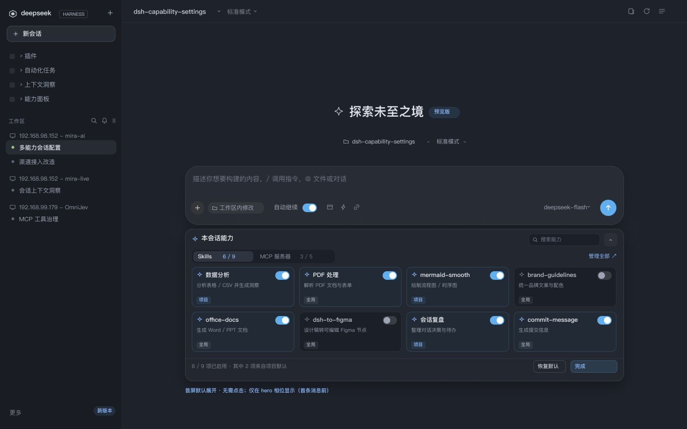
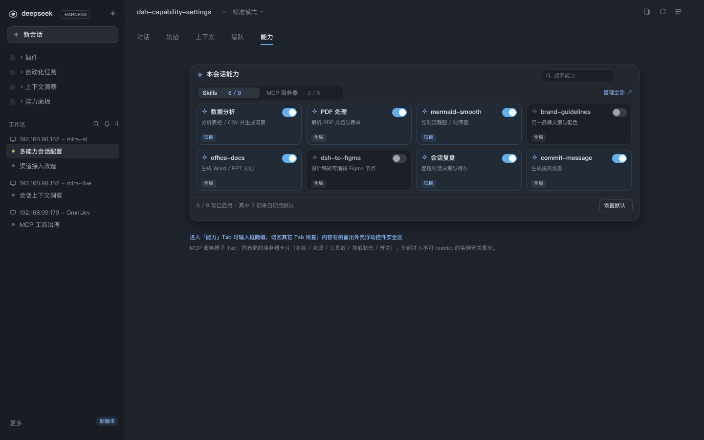
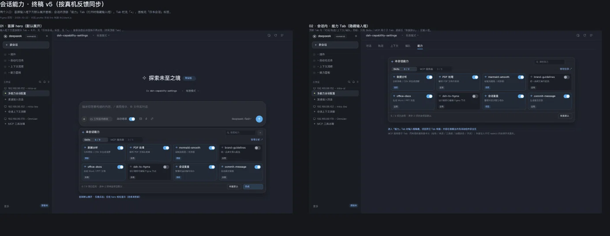
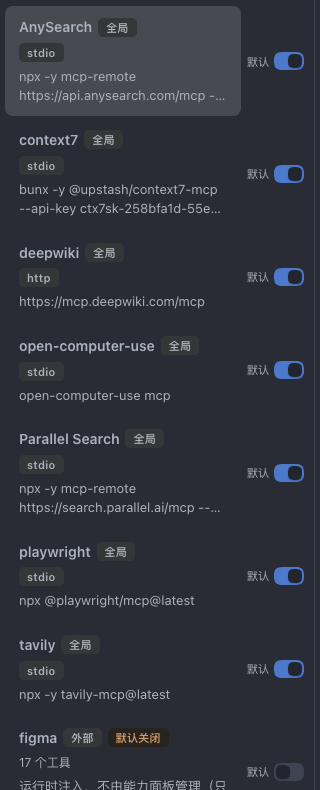
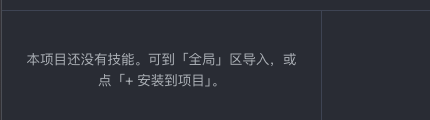

# Figma 资产盘点：Capability Dock · 终稿 v5 → 「能力面板」原型 v6

- 作者：scout-figma（DSH Agent Teams · 只读取证）
- 日期：2026-10-23
- 目标：为「能力面板」升级（侧栏入口 → 主区域页，技能 / MCP 两域；去掉快捷消息；技能详情展示 SKILL.md + 目录文件；项目与全局同屏）盘点可复用的 Figma 终稿资产。
- 设计源：Figma 本地文档 **`dsh`**（DSH to Figma 本地桥）
  - 页面 `Capability Dock · 终稿 v5` = page **`4:2`**
  - 画板 `00 · v5 终稿` = **`4:3`**
  - 画框 `01 · 首屏 hero · 输入框下方默认展开` = **`4:7`**
  - 画框 `02 · 会话内 · 能力 Tab（隐藏输入框）` = **`4:223`**
  - 历史页 `Capability Dock · 交互原型` = page **`1:2`**（v1–v4，只读参考，本次未逐层盘点）

> **重要前提（工具限制，先读）**：本 teammate 会话的 Agent 工具视图里**没有** `mcp__figma__get_metadata` / `get_screenshot` / `download_assets` / `use_figma` 等画布工具（仅 `figma_status` / `figma_setup` / `figma_read_guide` / `figma_select_document` / `figma_reconnect`，见 §1）。执行 `figma_reconnect` 后仍未出现；**Lead 会话可用，并已代跑 `get_metadata depth 2`（node id 见 §2.1）与 `list_fonts`（字体见 §9）**。
> 因此本文的**逐层结构、颜色、字体、尺寸**来自同一文档、同一节点的**真实导出物**：
> - `docs/figma/scenes/01-hero.scene.json`、`02-capability-tab.scene.json`：从 4:7 / 4:223 用 `use_figma` 脚本导出的完整图层树（名称 / 坐标 / 尺寸 / SOLID 填充 / 圆角 / 描边 / 自动布局 / 文字样式），**不含 node id**；
> - `.figma/assets/4e08ae35-…/1-…png`、`2-…png`（= `docs/figma/preview/*.png`，SHA1 一致）：4:7 / 4:223 的真实 PNG 导出；
> - `notes/design/14-figma-v5-board.png`：4:3 画板预览（1410×546 缩放图）。
> **结论**：画框 / 一级容器 / 关键容器的 node id 已通过 Lead 会话的 `get_metadata depth 2` **实测**（§2.1）；**更深层图层 id 依据 scene JSON 图层路径**（scene 导出不含 id），表中凡标 ✅ 的行为实测 id，未标 id 的行按路径定位。若需更深层 id，Lead 会话可对目标节点再跑一次 `get_metadata` 回填。

---

## 0. 给 designer 的十行摘要（TL;DR）

1. v5 的**视觉语言可整体复用**：面板壳（920×320 r16）、分段 Tab（300×28 / 项 22h）、卡片（215×84 r10）、标签（30×16 r4）、开关（30×18）、按钮（68/98×26）、统计页脚（11px）——只是要**从「卡片网格」改造成「列表行 + 详情」**。
2. v5 里**没有**：详情页、文件树、代码块、路径块、空态、项目/全局同屏分组、MCP 行。这些都要新建（§6.3）。
3. 关键几何：面板内边距 14、卡片列 gap 10、行距 94（84+10）、Tab 轨道内缩 3、按钮水平内边距 9、标签水平内边距 5。
4. 字体只用 **PingFang SC Regular / Medium / Semibold**；字号阶梯 9.5–14 + 26（标题）。
5. 主蓝 **#61AFEF**（亮蓝文字 #8FBCFF）；底色族 **#191C22 / #1E222B / #23272F / #222A35 / #1B1F27**；白色只做 5–14% 描边分层。
6. 建议新画框 **1632×1056**（与真机截图 1631×1065 / 1629×1056 同尺度）；备选 1440×900（与 v5 并排）。
7. 建议三栏：列表 **380** + 详情 **640** + 文件树 **244**（gap 16，padding 40；合计 1296 = 1376 主区 − 2×40）。
8. 域 Tab 不要再用现状「整行三等分大 Tab」——去快捷消息后剩两段会空一半；改用 v5 的 segmented（技能 / MCP）。
9. 项目 / 全局**不再做二选一子 Tab**：左列表用「项目 · n」「全局 · n」两个分组标题 + 组内行；项目为空时组内嵌一行空态 + 「+ 安装到项目」。
10. 已知限制：scene 契约不支持 VECTOR 图标（导入后图标为空）、只保留 SOLID 填充/描边/圆角/自动布局（**但本文件 4:7 / 4:223 的图层实际全是绝对坐标，没有 Auto Layout**，见 §3 注）、字体 PingFang SC；画布写操作必须 Lead 会话执行（§10）。

---

## 1. 连接与工具状态（figma_status 实测）

```text
backend: local            available: true
documents: [{ name: "dsh", editorType: "figma",
              connectionId: "fbd73724-ddd9-4b79-b621-95f948009731",
              busy: false, needsInspection: false }]
bridgePort: 3055          companion.paired: true
tools(17): use_figma, get_selection, list_fonts, get_metadata, get_screenshot,
           get_design_context, get_figjam, get_variable_defs, get_libraries,
           search_design_system, get_component_context, get_local_component_links,
           set_local_component_links, get_motion_context, upload_assets,
           download_assets, import_scene
```

- 文档**已连接**，单文档、本地后端，伴生插件在线。
- 但上述 17 个画布工具**未注册到本 agent 的工具视图**（用 cordis Inspect `Tool.listTools` 实测：可调用工具 133 个，figma 前缀仅 5 个 setup/guidance 工具）。`figma_reconnect` 后复核，仍未出现 → **teammate 不可画布读写，只有 Lead 会话可以**。
- 历史页 `1:2`（v1–v4）未盘点：只读参考，且不含本次可直接复用的新结构。

### 1.1 证据文件（全部在仓库内，可复核）

| 文件 | 来源 | 用途 |
|---|---|---|
| `docs/research/figma-ref/frame-4-7-hero.png` | `.figma/assets/…/1-01-首屏-hero-…png` 复制（= `docs/figma/preview/01-hero.png`） | 4:7 真实画面 1440×900 |
| `docs/research/figma-ref/frame-4-223-capability-tab.png` | `.figma/assets/…/2-02-会话内-能力-Tab-…png` 复制（= `docs/figma/preview/02-capability-tab.png`） | 4:223 真实画面 1440×900 |
| `docs/research/figma-ref/frame-4-3-board.png` | `notes/design/14-figma-v5-board.png` 复制 | 4:3 画板（含 4:7 + 4:223） |
| `docs/research/figma-ref/current-*.png` | 从 `notes/design/reference/*.png` 裁切 | 现状 UI 局部（顶部 Tab / 详情头 / 列表行 / MCP 列表 / MCP 详情 / 空态） |
| `docs/figma/scenes/01-hero.scene.json`、`02-capability-tab.scene.json` | 仓库已有（本次只读） | 逐层结构、颜色、字体、几何 |

### 1.2 截图索引

| 4:7 首屏 hero | 4:223 会话内能力 Tab | 4:3 画板 |
|---|---|---|
|  |  |  |

| 现状：顶部 Tab | 现状：详情头 | 现状：MCP 列表 | 现状：空态 |
|---|---|---|---|
|  |  |  |  |


---

## 2. 画框与页面坐标

| 画框 | node id | 尺寸 | 页面坐标 (x,y) | 说明 |
|---|---|---|---|---|
| `00 · v5 终稿`（画板） | `4:3` | 预览图 1410×546（缩放导出，未随 scene 导出尺寸） | — | 包含下面两个画框；顶部有标注文字 |
| `01 · 首屏 hero · 输入框下方默认展开` | `4:7` | 1440×900 | (0, 150) | 侧栏 256 + 主区 1184；hero 状态 |
| `02 · 会话内 · 能力 Tab（隐藏输入框）` | `4:223` | 1440×900 | (1520, 150) | 与 4:7 同一行，**间距 80**；整页 Tab 状态 |

- 两个画框均为 `clipsContent: true`、填充 `#1E222B`，内部再分 `sidebar`(256×900) / `header`(1184×48) / `main`(1184×852)。
- 4:3 画板本身不是 scene 导出的目标节点，**其精确宽高未实测**；截图为 1410×546 的缩放图，只能确认「两画框并排 + 上方说明文字」。
- 4:7 与 4:223 的**内容区**（main）相同起点 `(256,48)`；4:223 的会话页 Tab 行高 48，其下内容从 y≈84 开始。

### 2.1 实测 node id（Lead 会话 `get_metadata depth 2`，✅ = 实测）

| node id | 名称 | 归属 | 尺寸/位置（实测或 scene） |
|---|---|---|---|
| ✅ `4:3` | 00 · v5 终稿（画板） | page 4:2 | 预览 1410×546 |
| ✅ `4:4` / `4:5` / `4:6` | 画板标题 / 副标题 / 日期 | 4:3 子层 | — |
| ✅ `4:7` | 01 · 首屏 hero 画框 | 4:3 子层 | 1440×900 @(0,150) |
| ✅ `4:221` / `4:222` | 首屏 captions / 首屏说明 | 4:3 子层 | — |
| ✅ `4:223` | 02 · 会话内能力 Tab 画框 | 4:3 子层 | 1440×900 @(1520,150) |
| ✅ `4:440` / `4:441` | 能力 Tab captions / 说明 | 4:3 子层 | — |
| ✅ `4:8` | sidebar | 4:7 直接子层 | 256×900，35 个子层 |
| ✅ `4:62` | header | 4:7 直接子层 | @(256,0) 1184×48 |
| ✅ `4:77` | main | 4:7 直接子层 | @(256,48) 1184×852 |
| ✅ `4:78` | 探索未至之境 | 4:77 子层 | 156×36 @(476,168) |
| ✅ `4:83` | workspace-row | 4:77 子层 | 300×26 @(459,236) |
| ✅ `4:92` | composer-card | 4:77 子层 | 920×124 r28 @(132,300) |
| ✅ `4:117` | **capability-panel** | 4:77 子层 | **920×320 r16 @(132,432)** |
| ✅ `4:220` | 首屏注释文字 | 4:77 子层 | 308×15 @(132,764) |
| ✅ `4:224` / `4:278` / `4:293` | sidebar / header / main | 4:223 直接子层 | 同 4:7 结构 |
| ✅ `4:333` | **capability-panel** | 4:293 子层 | **920×320 r16 @(132,84)** |
| ✅ `4:432`–`4:436` | 顶部页 Tab 文字：对话 / 轨迹 / 上下文 / 编队 / 能力 | 4:293 子层 | 13px，y=18 |
| ✅ `4:437` | 能力 Tab 下划线 | 4:293 子层 | 26×2 @(277,42) #61B0F0 |
| ✅ `4:438` | 页 Tab 分隔线 | 4:293 子层 | 1136×1 @(24,46) #FFFFFF@6% |
| ✅ `4:439` / `4:442` | 能力 Tab 注释文字 | 4:293 子层 | @(132,430) / (132,452) |

> 再次提醒：`4:117` / `4:333` 内部的图标、搜索、tabs、卡片、页脚等**没有实测 id**（depth 2 不下钻），下文用 `capability-panel / tabs / …` 的路径定位；需要时可对 `4:117` / `4:333` 再跑 depth 2–3 的 metadata。

---

## 3. 4:7 结构（深度 4–5，按图层路径；无逐层 node id）

层级记法：`4:7 / main / capability-panel / tabs / tab-skills-active`。所有尺寸单位 px。

> **布局方式实测：两个画框的 scene 导出中 `layoutMode` 出现次数为 0 —— 全部图层都是绝对坐标（x/y/宽/高）定位，没有使用 Auto Layout。** 复用时应沿用绝对坐标（挪动容器时子层跟着挪），或由 designer 在新画框里改用 Auto Layout（导出脚本会保留 layoutMode/itemSpacing/padding）。


### 3.1 顶层骨架

| 层路径（✅ 有实测 id） | 类型 | 尺寸 | 位置 | 关键属性 |
|---|---|---|---|---|
| `4:7` | FRAME | 1440×900 | (0,150) | 填充 #1E222B |
| `4:7 / sidebar` ✅ `4:8` | FRAME | 256×900 | (0,0) | #191C22，35 个子层 |
| `4:7 / sidebar / side-border` | RECT | 1×900 | (255,0) | #FFFFFF@5% |
| `4:7 / sidebar / new-session` | FRAME | 228×34 | (14,54) | #262B34，描边 #FFFFFF@12% 1px，r10 |
| `4:7 / sidebar / menu-dot-*` | RECT ×4 | 11×11 | (20,113) 起，行距 30 | #FFFFFF@8%，r3 |
| `4:7 / sidebar / active-row` | RECT | 232×30 | (12,294) | #262B34，r8（选中会话行） |
| `4:7 / sidebar / 工作区` | TEXT | 34×16 | (18,246) | 11 Medium #6F7787，lh16，字距 0.4 |
| `4:7 / header` ✅ `4:62` | FRAME | 1184×48 | (256,0) | #1E222B；`header-line` 1184×1 #FFFFFF@5% |
| `4:7 / main` ✅ `4:77` | FRAME | 1184×852 | (256,48) | #1E222B |

### 3.2 main 的四个内容块

| 层路径（✅ 有实测 id） | 类型 | 尺寸 | 位置 | 关键属性 |
|---|---|---|---|---|
| `main / 探索未至之境` ✅ `4:78` | TEXT | 156×36 | (476,168) | 26px Semibold #DFE4EC，lh36 |
| `main / preview-tag` | FRAME | 66×24 | (642,176) | #61AFEF@12%，r999；文字「预览版」11 Medium #8FBCFF |
| `main / workspace-row` ✅ `4:83` | FRAME | 300×26 | (459,236) | r8（图标 + 项目名 12 Regular #C9CED8 + 标准模式 12 Regular #9DA5B4） |
| `main / composer-card` ✅ `4:92` | FRAME | 920×124 | (132,300) | #282C34，描边 #FFFFFF@7% 1px，**r28** |
| `main / capability-panel` ✅ `4:117` | FRAME | 920×320 | (132,432) | **#23272F，描边 #FFFFFF@10% 1px，r16** |
| `main / 首屏默认展开…`（注释） ✅ `4:220` | TEXT | 308×15 | (132,764) | 11 Medium #8FBDFF |

> 面板宽度固定 920，左右留白 (1184−920)/2 = 132。**主区内容以 920 为容器宽度**，不是满宽。

### 3.3 capability-panel 内部（父节点 ✅ `4:117`；内部层为 scene 路径，未实测 id）

> 以下各层的**父容器 id = `4:117`**；层内 id 未实测，按名称/路径定位（对 `4:117` 再跑 depth 2–3 的 `get_metadata` 可得）。

| 层路径（相对 `4:117`） | 类型 | 尺寸 | 位置 | 关键属性 |
|---|---|---|---|---|
| `capability-panel / Frame`（图标） | FRAME | 14×14 | (14,15) | 无填充（v5 里是 VECTOR 图标位，导入会丢） |
| `capability-panel / 本会话能力` | TEXT | 68×22 | (34,8) | 13.5 Semibold #E3E6EA，lh22 |
| `… / search` | FRAME | 150×26 | (720,10) | #1B1F27，描边 #FFFFFF@8%，r8 |
| `… / search / Frame` | FRAME | 12×12 | (8,7) | 搜索图标位（VECTOR） |
| `… / search / 搜索能力` | TEXT | 44×16 | (25,4) | 11 Regular #6F7787，lh16 |
| `… / collapse` | FRAME | 28×28 | (878,9) | #FFFFFF@4%，r8（折叠按钮） |
| `… / tabs` | FRAME | 300×28 | (14,44) | **#1B1F27，r9**（分段轨道） |
| `… / tabs / tab-skills-active` | FRAME | 126×22 | (3,3) | **#2E3540，r7**；`Skills` 11.5 Semibold #E3E6EA；`6 / 9` 11 Medium #8FBCFF |
| `… / tabs / tab-mcp` | FRAME | 140×22 | (133,3) | 透明；`MCP 服务器` 11.5 Regular #8F97A6；`3 / 5` 11 Regular #6F7787 |
| `… / 管理全部 ↗` | TEXT | 59×16 | (846,49) | 11 Regular #8FBCFF |
| `… / card-<name>` ×8 | FRAME | 215×84 | 行 y=80 / 174；列 x=14 / 239 / 464 / 689 | 4 列，列 gap 10，行 gap 10，r10 |
| `… / footer-line` | RECT | 920×1 | (0,272) | #FFFFFF@6% |
| `… / 6 / 9 项已启用…` | TEXT | 200×16 | (14,280) | 11 Regular #7F848E，lh16 |
| `… / reset-default` | FRAME | 68×26 | (730,276) | 描边 #FFFFFF@14%，r7；文字 11 Medium #C9CED8（内边距 9/4） |
| `… / done` | FRAME | 98×26 | (808,276) | #61AFEF@15% + 描边 #61AFEF@25%，r7；文字「完成」11 Medium #8FBCFF |

卡片（开关开 / 关两种变体，均 215×84 r10，内边距 10）：

| 子层 | 尺寸 | 位置 | 开态 | 关态 |
|---|---|---|---|---|
| 卡片底 | 215×84 | — | #222A35 + 描边 #61AFEF@20% | #1B1F27 + 描边 #FFFFFF@7% |
| 图标位 | 13×13 | (10,10) | — | — |
| 名称 | ~195×18 | (29,7) | 12.5 Semibold #E3E6EA | 12.5 Semibold #B9C0CB |
| 开关 | 30×18 | (175,9) | 轨道 #61AFEF，knob 14×14 #FFFFFF @(14,2) r7 | 轨道 #FFFFFF@13%，knob 14×14 #9DA5B4 @(2,2) r7 |
| 描述 | 195×14 | (10,31) | 10.5 Regular #8F97A6，lh14 | 同左 |
| 标签 | 30×16 | (10,62) | 项目：底 #61AFEF@10%，字 #8FBCFF；全局：底 #FFFFFF@6%，字 #9DA5B4；9.5 Medium lh16，水平内边距 5 | 同左 |

---

## 4. 4:223 结构（深度 4–5，按图层路径）

### 4.1 与 4:7 的差异（复用要点）

| 差异 | 4:7 | 4:223 |
|---|---|---|
| 输入框 | `composer-card` 在面板上方 | **不存在**（打开能力 Tab 隐藏输入框） |
| 页面级 Tab | 无 | `main / 对话 / 轨迹 / 上下文 / 编队 / 能力`（y=18；13px；选中 #E3E5EB Semibold + 下划线） |
| 面板位置 | `(132,432)`（输入框下方） | `(132,84)`（页 Tab 下方） |
| 面板内容 | 标题 + 搜索 + 折叠 + Tab + 4×2 卡片 + 页脚（重置 + 完成） | 同左，但**无折叠按钮**；页脚**只有重置**（无「完成」） |
| 安全区 | 无 | 右侧预留 64px 外壳浮动控件安全区（注释 11 Medium #8FBDFF） |

### 4.2 4:223 关键层（✅ = 实测 id）

| 层路径（✅ 有实测 id） | 类型 | 尺寸 | 位置 | 关键属性 |
|---|---|---|---|---|
| `4:223 / sidebar` ✅ `4:224` | FRAME | 256×900 | (0,0) | 同 4:8 |
| `4:223 / header` ✅ `4:278` | FRAME | 1184×48 | (256,0) | 同 4:62 |
| `4:223 / main` ✅ `4:293` | FRAME | 1184×852 | (256,48) | 同 4:77 |
| `4:293 / 对话` ✅ `4:432` | TEXT | 26×18 | (24,18) | 13 Regular #808799 |
| `4:293 / 轨迹` ✅ `4:433` | TEXT | 26×18 | (84,18) | 同上 |
| `4:293 / 上下文` ✅ `4:434` | TEXT | 39×18 | (144,18) | 同上 |
| `4:293 / 编队` ✅ `4:435` | TEXT | 26×18 | (217,18) | 同上 |
| `4:293 / 能力` ✅ `4:436` | TEXT | 26×18 | (277,18) | **13 Semibold #E3E5EB**（选中） |
| `4:293 / 能力下划线` ✅ `4:437` | RECT | 26×2 | (277,42) | #61B0F0 |
| `4:293 / 页 Tab 分隔线` ✅ `4:438` | RECT | 1136×1 | (24,46) | #FFFFFF@6% |
| `4:293 / capability-panel` ✅ `4:333` | FRAME | 920×320 | (132,84) | 同 3.3，无 collapse；页脚仅 reset-default @(838,276) |
| `4:293 / …注释1` ✅ `4:439` | TEXT | 436×15 | (132,430) | 11 Medium #8FBDFF：进入 Tab 时输入框隐藏 / 右侧安全区 |
| `4:293 / …注释2` ✅ `4:442` | TEXT | 631×15 | (132,452) | 11 Regular #808799：MCP 子 Tab 同布局说明 |

> 页面级 Tab 的「13px + 2px 下划线 + 6% 分隔线」是**外壳导航样式**，不是域 Tab。新面板的「技能 / MCP」应当用 v5 的 segmented（§5.3），不要混用这两种 Tab。

---

## 5. 视觉规范

### 5.1 色板（v5 设计值，均可从 scene JSON 复核）

| 用途 | HEX | 出现位置 |
|---|---|---|
| 侧栏底 | `#191C22` | sidebar |
| 页面 / 主区底 | `#1E222B` | 4:7 / 4:223 画框、header、main |
| 面板底 | `#23272F` | capability-panel |
| 卡片（开态） | `#222A35` | 开态卡片底 |
| 卡片（关） | `#1B1F27` | 卡片关态、Tab 轨道、搜索框底 |
| Tab 选中项 | `#2E3540` | tab-skills-active |
| 输入卡底 | `#282C34` | composer-card |
| 新会话 / 选中会话行 | `#262B34` | new-session、active-row |
| 主文字 | `#E3E6EA` / `#DFE4EC` | 面板标题、卡片名、hero 标题 |
| 次文字 | `#9DA5B4` / `#8F97A6` | 描述、Tab 未选中、标签（全局） |
| 弱文字 | `#6F7787` / `#7F848E` / `#808799` / `#5C6370` | placeholder、页脚统计、页 Tab 未选中 |
| 亮文字 | `#C9CED8` / `#B9C0CB` | 按钮文字、关态卡片名 |
| 主蓝（描边/开关/强调） | `#61AFEF` | 开关开、主按钮描边、激活卡描边 |
| 亮蓝（文字/链接） | `#8FBCFF` / `#8FBDFF` | 标签（项目）、链接、计数、注释 |
| 绿（在线/成功） | `#98C379` | 会话在线点 |
| 页面级 Tab 下划线 | `#61B0F0` | 4:223 能力 Tab |

白色描边/填充比例（v5 全部走白透明度，没有实心白灰）：`@4%`（折叠钮底）、`@5%`（侧栏边、header 线、worktree chip）、`@6%`（分组标签底、分隔线）、`@7%`（输入卡描边、关态卡片描边）、`@8%`（搜索描边、菜单点）、`@10%`（面板描边）、`@12%`（新会话描边）、`@13%`（关态开关轨道）、`@14%`（次按钮描边、HARNESS 徽标描边）。

> 蓝透明度：`#61AFEF@10%`（项目标签底）、`@12%`（预览版标签底）、`@15%`（完成按钮底）、`@20%`（开态卡片描边）、`@25%`（完成按钮描边）。

### 5.2 字体与字号阶梯（PingFang SC）

| 字号 | 字重 | 行高 | 用途 |
|---|---|---|---|
| 26 | Semibold | 36 | hero 标题「探索未至之境」 |
| 14 | Semibold / Regular | 20 / 22 | 品牌名 / 输入框 placeholder |
| 13.5 | Semibold | 22 | 面板标题「本会话能力」 |
| 13.5 | Medium | 默认 | header 项目名 |
| 13 | Medium / Regular | 默认 | 新会话、侧栏导航、页面级 Tab（选中 Semibold） |
| 12.5 | Semibold | 18 | 卡片名称 |
| 12.5 | Regular / Medium | 20 | 自动继续、模型名、会话名 |
| 12 | Regular / Medium | 18 | 卡片? / 工作区标题、workspace-row 文字 |
| 11.5 | Semibold / Regular | 18 | 分段 Tab 标签（选中 Semibold） |
| 11 | Medium / Regular | 16 | 按钮文字（Medium）、链接、统计、搜索 placeholder、标签? |
| 10.5 | Medium / Regular | 15/14 | 「新版本」徽标、卡片描述（Regular） |
| 9.5 | Medium | 16 | 标签文字（项目 / 全局）、HARNESS 徽标 |

- 只用 **Regular / Medium / Semibold** 三档；无 Bold、无 Italic。
- 小字带正字距：11px「工作区」类分组标题 `letter-spacing 0.4`。
- 中文 + 拉丁混排，数字有空格习惯（`6 / 9`、`3 / 5`）。

### 5.3 间距与节奏

- 基础节奏：`2 / 3 / 4 / 6 / 8 / 10 / 14 / 16 / 24`。
- 面板内边距 **14**（上下左右一致）；卡片列 gap **10**；卡片行距 **94**（84 高 + 10 gap）。
- 面板内部纵向节奏：标题行 y 8–30（22 高）→ Tab 44–72（28 高）→ 卡片 80（首行）→ 页脚分隔线 272 → 页脚文字 280（16 高）→ 底部留白约 18。
- 侧栏：左右 14–18，导航行距 30，分组标题上间距约 20。
- 主区 hero：标题 y168（高 36）→ workspace-row y236（高 26，间距 32）→ composer y300（间距 38）→ 面板 y432（间距 8）。
- 4:223：页 Tab 行 0–48（文字 y18 高 18、下划线 y42 高 2、分隔线 y46）→ 面板 y84（分隔线下 37）→ 注释 y430 / y452。

### 5.4 圆角

| 值 | 用途 |
|---|---|
| **999** | 胶囊：预览版/新版本标签、worktree chip、开关轨道 |
| **28** | 输入卡 composer-card（大圆角） |
| **17 / 14** | 发送圆钮 34×34 / 加号钮 28×28 |
| **16** | 能力面板壳 |
| **10** | 卡片、新会话按钮 |
| **9** | 分段 Tab 轨道 |
| **8** | 搜索框、折叠钮、active-row、workspace-row |
| **7** | 分段 Tab 项、次/主按钮、开关 knob |
| **4** | 标签、HARNESS 徽标 |
| **3** | 菜单点 |

### 5.5 描边

- 分离层次全靠 **1px 白色低透明度描边**：面板 10%、卡片（关）7%、搜索 8%、次按钮 14%、新会话 12%、分隔线 6%、侧栏边 5%。
- 蓝描边只用于「激活/主操作」：开态卡片 20%、主按钮 25%。
- 无阴影、无渐变（scene 导出也不保留这些）。

### 5.6 控件规格速查

| 控件 | 尺寸 | 内边距 | 说明 |
|---|---|---|---|
| 能力面板 | 920×320 | 14 | r16，#23272F，白 10% 描边 |
| 面板标题行 | 高 22 | 图标 14 + 间距 6 | 13.5 Semibold |
| 搜索框 | 150×26（现状主页面可放大到 240–280×30/32） | 左 8，图标 12，文字左 25 | r8，#1B1F27，白 8% 描边 |
| 折叠/小方钮 | 28×28 | 图标 12 居中 | r8，白 4% 底 |
| 分段 Tab 轨道 | 300×28 | 3 | r9，#1B1F27 |
| 分段 Tab 项 | 126×22 / 140×22（随文字） | 左右 10 | r7；选中 #2E3540 |
| 技能/MCP 卡片 | 215×84 | 10 | r10；图标 13、名称 12.5/18、描述 10.5/14、标签 30×16 |
| 标签 | 高 16，宽随文字（30 为两字） | 左右 5 | r4，9.5 Medium/16 |
| 开关 | 30×18 | knob 14×14 r7 | 开：轨道 #61AFEF、knob x14；关：轨道白 13%、knob x2 |
| 次按钮 | 68×26 | 左右 9、上下 4 | r7，白 14% 描边，字 #C9CED8 11 Medium |
| 主按钮 | 98×26 | 左右 9、上下 4 | r7，蓝 15% 底 + 蓝 25% 描边，字 #8FBCFF |
| 链接 | 高 16 | — | 11 Regular #8FBCFF（「管理全部 ↗」） |
| 统计文字 | 高 16 | — | 11 Regular #7F848E |
| 输入卡 | 920×124 | 16 | r28，#282C34，白 7% 描边 |
| 发送钮 | 34×34 | 图标 16 | r17，#61AFEF |
| 侧栏新会话 | 228×34 | 左右 12 | r10，#262B34，白 12% 描边 |
| 侧栏选中行 | 232×30 | 左 12 | r8，#262B34 |

---

## 6. 可复用结构清单（→ 新「能力面板」映射）

### 6.1 可直接复用（几何/样式不变，仅换内容/尺寸）

| # | v5 结构（层路径） | 现规格 | 新面板用途 | 需要的改动 |
|---|---|---|---|---|
| R1 | `4:7 / main / capability-panel`（✅ `4:117`） / `4:223` 版（✅ `4:333`） | 920×320 r16 #23272F 白10% | 页面内容容器（详情卡 / 列表容器） | 改成满宽容器或分区卡片；圆角 12–16 保持 |
| R2 | `… / tabs` + `tab-skills-active` + `tab-mcp` | 轨道 300×28 r9；项 22h r7 | **域 Tab：技能 / MCP**（去掉快捷消息） | 两段即可；计数字段可保留（`12` / `5`） |
| R3 | `… / search` | 150×26 r8 | 域内搜索（技能名 / MCP 名） | 放大到 240×30，placeholder 改「搜索技能…」「搜索 MCP 服务器…」 |
| R4 | `… / collapse` | 28×28 r8 | 刷新 / 更多 / 折叠文件树 | 图标替换（VECTOR 限制见 §10） |
| R5 | `switch-on` / `switch-off` | 30×18 | 技能启用开关、MCP「默认」开关 | 不需要改；只读/外部禁用态置灰 |
| R6 | `tag-项目` / `tag-全局` | 30×16 r4 | 列表行来源标签 + 详情头标签 | 新增「只读」「外部」「默认关闭」三个变体（§6.3） |
| R7 | `reset-default` / `done` | 68×26 / 98×26 r7 | 详情操作行的次级/主按钮 | 高度可提到 28–30；主按钮可改实心蓝 |
| R8 | `footer-line` + 统计文字 | 920×1 白6% + 11/16 | 列表分组计数、详情底部统计 | 直接复用 |
| R9 | `… / 管理全部 ↗` | 11 #8FBCFF | 组标题右侧「全部」/「导出」等链接 | 直接复用 |
| R10 | `sidebar / active-row` + `menu-dot-能力面板`（✅ 侧栏 `4:8` / `4:224`） | 232×30 r8 / 11×11 r3 | 侧栏入口选中态（新页面由侧栏进入） | 入口名改为「能力面板」，选中态复用 |
| R11 | `preview-tag` | 66×24 r999 蓝12% | 组标题旁的「项目/全局」胶囊 / 空态徽标 | 可作分组胶囊 |
| R12 | `header` + `header-line`（✅ `4:62` / `4:278`） | 1184×48 + 1px 白5% | 页面顶栏（面包屑 + 右侧操作） | 高度保持 48–52 |
| R13 | 页面级 Tab（✅ `4:436` 能力 + ✅ `4:437` 下划线，分隔线 ✅ `4:438`） | 13px + 26×2 下划线 | **不建议**用于域 Tab；可留给外壳导航 | 仅参考 |

### 6.2 需改造复用（骨架在，形态要变）

| # | v5 结构 | 改造目标 | 要点 |
|---|---|---|---|
| M1 | 卡片 `card-*`（215×84 r10，图标/名称/开关/描述/标签） | **技能列表行**（建议 380×56~64 r10） | 名称 13 Medium + 描述 11/16 单行截断 + 来源标签；开关移到行右；选中态 `#2E3540` + 左 2px 蓝条（或蓝 20% 描边） |
| M2 | 卡片骨架 | **MCP server 行**（380×64） | 名称 13 Medium + transport 标签（stdio/http）+ 命令/URL 10.5 mono 单行截断 + 右侧「默认」开关；行高可按两行内容用 72 |
| M3 | 面板标题行（图标 + 13.5 Semibold） | **列表分组标题**（项目 · n / 全局 · n） | 11 Medium #6F7787 + 字距 0.4（复用侧栏「工作区」样式）+ 右侧计数 11 #7F848E；高 28–32 |
| M4 | `done` 主按钮 | **详情主操作**（安装到项目 / 启用） | 28–30 高，实心 #61AFEF 或蓝 15% 底；危险动作沿用现状红色文字（#E06C75，无边框） |
| M5 | 卡片内描述层级 | **SKILL.md 正文排版** | 标题 15/22 Semibold、正文 12/20 Regular、列表缩进 16、行距 20；宽度 600–640 |
| M6 | 标签 | **只读 / 外部 / 默认关闭** | 只读：底 #FFFFFF@6% + 字 #9DA5B4 + 1px #FFFFFF@10%；外部：底 #C99563@12% + 字 #D8A26A（与现状琥珀 #27241F/#D19A66 对齐）；默认关闭：底 #98C379@12% + 字 #A8CE8C 或沿用现状琥珀，建议与「外部」区分色相 |

### 6.3 必须新建的节点类型（v5 没有）

| 新节点 | 建议规格 | 复用参照 |
|---|---|---|
| 详情头 `detail-header` | 标题 20–22 Semibold #E3E6EA；第二行路径 11/16 #8F97A6；标签右上 | hero 标题 26 + header 项目名 |
| 详情操作行 `detail-actions` | 高 32，按钮 gap 8；主/次/危险 | R7 + 现状「导入到项目 / 在本项目禁用 / 导出 / 删除」 |
| 路径块 `path-block` | 满宽 ×32，r8，#1B1F27，白 8% 描边，左侧内边距 10；等宽 11/16 #9DA5B4；可加右侧「复制」图标 | search 底 + worktree chip |
| 代码块 `code-block` | 满宽，r8，#1B1F27，内边距 10–12；等宽 11/18 #C9CED8；语言标签可选 | 新增（与路径块同族） |
| 文件树 `file-tree` | 宽 244；行高 28；缩进 16/层；图标 13×13；文件名 11.5/18；目录 Medium、文件 Regular；选中行 #2E3540 r6 | 侧栏导航行（尺寸放大） |
| 列表行 `row-skill` / `row-mcp` | 380×56 / 380×64，r10；hover #262B34；选中 #2E3540 | M1/M2 |
| 分组容器 `list-group-project` / `list-group-global` | 组标题 30 + 行列表；组间距 16；可选粘性标题 | M3 |
| 空态 `empty-state` | 图标/徽标 32–40 + 标题 13 Medium + 说明 11.5/18 #8F97A6 + 主按钮；居中，最大宽 280 | preview-tag 胶囊 + done 按钮 |
| 详情空态 `detail-empty` | 文案「选择一项技能查看详情」11.5 #6F7787 居中 | 现状 |
| 项目空组内嵌 `empty-project-inline` | 一行说明 + 内联「+ 安装到项目」链接，**不再让用户切 Tab** | 现状空态文案改造 |
| MCP 工具/使用记录区块 | 详情右栏 288 宽卡片：状态点 + 工具数 + 最近调用；或折叠区 | 新增 |

---

## 7. 与现状 UI 的对比（notes/design/reference/*.png 实测）

截图尺寸：`current-skills-global.png` 1631×1065、`current-mcp-global.png` 1629×1056、`current-skills-project-empty.png` 1899×1041（含侧栏）。下列像素值由 PIL 采样，四舍五入。

### 7.1 现状结构

| 区域 | 现状（实测） | 问题 |
|---|---|---|
| 顶部域 Tab | 整行 **1598×38**（x 20–1618），三等分各 ~533；底 #353638，选中段 #22252B（更暗的「凹陷」选中） | 去「快捷消息」后只剩 2 段，**每段 799 宽会非常空**；三等分大 Tab 与 v5 segmented 语言不一致 |
| 项目/全局 子 Tab | 左侧 **约 122×38** 的胶囊组（x18–140, y123–161），选中项 #22252B | **强制二选一**：项目与全局无法同屏对照；项目为空时用户看到空列表 + 需切「全局」 |
| 搜索 | **1344×~28**（x156–1500）横贯整行 | 过宽，与「+ 安装到全局」按钮争抢注意力；placeholder 只有单一域 |
| 主操作按钮 | 「+ 安装到全局」106×30 @(1514,126)，#4D79CD | 操作入口随「项目/全局」变化，位置固定但语义易混 |
| 左列表 | 宽 **~310**（x8–318），行高 84（选中行约 300×84，#474A51） | 行内塞名称 + 两行描述，长名称（acquisition-channel-advisor）与描述被截断；来源信息弱（只有详情里能看到） |
| 详情 | 起于 x≈328，宽 ~1290；标题约 20–22 Semibold；标签「全局」；操作行 5 个按钮（约 28–30 高）；「描述 / 来源 / 路径」三块 | **大量留白**（详情只到 y≈500，下方 ~500px 空）；技能**不展示 SKILL.md 内容**、不展示目录文件；路径块只有一行截断 |
| MCP 列表行 | 310×84：名称 + 「全局」标签 + 「默认」开关 + transport 小标签（stdio/http）+ 命令/URL 两行截断 | 信息过密；命令被 `...` 截断且不可复制；「外部」「默认关闭」用琥珀标签堆叠，层级不清 |
| MCP 详情 | 名称 + 5 按钮 + 命名空间 / 命令 / 参数 / 配置文件 / 状态，字段值用 #353638 长条块横排 | 参数是超长单行（`-y mcp-remote https://… --header "Authorization: Bearer …"`）不换行、不可复制；**Token 级参数直接裸露**，原型里应有遮蔽/展开策略 |
| 空态 | 只有一段文字「本项目还没有技能。可到「全局」区导入，或点「+ 安装到项目」。」+ 右侧「选择一项技能查看详情。」 | 无图标、无 CTA 按钮；空态与主操作分离；全局内容被隐藏 |
| 右上角 | 「跟随当前会话」下拉 | 管理页语义可疑（管理的是项目/全局配置，不是会话态），需产品确认去留 |
| 色板 | 底 #292C34、列表/输入块 #22252B/#353638、文字 #ABB2C0、主蓝按钮 #4D79CD、标签绿 #233C2C/#2C9063、琥珀 #27241F/#D19A66 | **与 v5 设计值不同**（v5 底 #1E222B / 面板 #23272F / 主蓝 #61AFEF），新原型需二选一（见 §11 开放问题） |

### 7.2 现状信息密度问题（一句话版）

1. **域 Tab 占了一整行**（38px 高、1598 宽），却只承载 2–3 个选项。
2. **项目/全局二选一 Tab** 是「减少点击」需求的核心痛点：对照、导入、复制都要来回切。
3. **技能详情只读元数据**（描述/来源/路径），没有 SKILL.md 正文与目录文件 → 用户无法判断技能到底做什么。
4. **列表行密度过高**（名称+两行描述+标签挤在 84px），详情又**信息过少、留白过多**。
5. **空态无 CTA、无上下文**（看不到全局里有什么可选）。
6. MCP 行把「来源 / 挂载 / 默认开关 / 命令」全塞进 84px；详情把长参数压成不可读的单行块。

---

## 8. designer 建议

### 8.1 画框尺寸

| 方案 | 尺寸 | 理由 | 风险 |
|---|---|---|---|
| **A（推荐）** | **1632×1056** | 与真机截图 1631×1065 / 1629×1056 同尺度，可 1:1 对照现状；若按 256 侧栏，主区约 1376，三栏（380+640+244+2×16）刚好 1296 + 2×40 padding = 1376 | 与 v5 1440×900 画框不同尺寸，需单独导出 scene（scene 契约本身不限尺寸） |
| B | 1440×900 | 与 4:7 / 4:223 并排一致，导出/对照成本低 | 主区仅 1184：三栏需压到 360 + 520 + 240（gap 16，padding 24）= 1176，详情偏窄（SKILL.md 正文 520 可读性一般） |
| C（可选） | 1632×1056 + 1440×900 各一张 | A 用于验收、B 用于和 v5 同尺度对比 | 多一张导出维护 |

> 建议 A + 一张 `1440×900` 窄屏降级小样（列表折叠成 320，文件树收进详情内 Tab）。如果只做一张，选 A。

### 8.2 建议布局（1632×1056，全壳：侧栏 256 + 主区 1376）

```text
┌──────────┬───────────────────────────────────────────────────────────────────────┐
│ sidebar  │ header 1376×52：面包屑「能力面板」+ 项目路径 ……… 右侧：刷新 / 更多     │
│ 256      ├───────────────────────────────────────────────────────────────────────┤
│          │ page-head 1376×72：标题「技能」/「MCP 服务器」+ 说明 + 右侧域 Tab       │
│          │   [ 技能 12 | MCP 5 ]  ← segmented（复用 v5 tabs，放大到 260×32）      │
│          ├───────────────┬───────────────────────────────────┬───────────────────┤
│          │ 列表 380      │ 详情 640                          │ 文件树 244        │
│          │ ┌ 搜索 380×32 │ ┌ detail-header 640×64            │ SKILL.md 目录     │
│          │ │ 项目 · 3    │ │  名称 20 Semibold + tag          │   ├ assets/       │
│          │ │  row-skill  │ │  路径 11/16                      │   ├ SKILL.md      │
│          │ │  row-skill  │ ├ detail-actions 640×32            │   └ examples/     │
│          │ │ 全局 · 12   │ ├ SKILL.md 正文（滚动区）           │                   │
│          │ │  row-skill  │ │  H1 15/22 · 正文 12/20 · 代码块    │ 244×?             │
│          │ │  …          │ │  path-block / code-block          │                   │
│          │ └─────────────┴───────────────────────────────────┴───────────────────┘
│          │ 底部：统计 11/16（如「项目 3 · 全局 12 · 已启用 8」）
└──────────┴───────────────────────────────────────────────────────────────────────┘
```

- 主区 padding 40；三栏固定宽、gap 16；列表与详情各自独立滚动，文件树跟随详情滚动或不滚动（建议固定，内容多时内部滚动）。
- 域 Tab 放 page-head 右侧（或标题下方一行，高 40），**不再整行铺满**。
- 项目 / 全局同屏：左列表两个分组（`项目 · n` / `全局 · n`）；项目空时组内渲染 `empty-project-inline`（一行说明 + 「+ 安装到项目」链接），全局组紧接其下。
- MCP 域：三栏改为两栏（列表 380 + 详情 900）；原文件树列换成「状态 / 工具数 / 使用记录」摘要卡（288×auto）放在详情右内侧或详情底部。
- 技能详情：标题 + 来源标签 + 路径块 + 操作行 + SKILL.md 渲染（H1/H2、段落、列表、代码块、引用）+ 底部「文件」区块（若不做右侧文件树，可把文件列表放正文下方）。
- 需要额外画框：① 技能-项目+全局 ② 技能-项目为空 ③ MCP-项目+全局 ④ 技能详情-长 SKILL.md（滚动中段）⑤ 搜索空态 / 详情空态 ⑥（可选）MCP 编辑弹层。

### 8.3 需要新建的节点类型

见 §6.3。核心 8 类：`detail-header`、`detail-actions`、`path-block`、`code-block`、`file-tree`、`row-skill`/`row-mcp`、`list-group-*`、`empty-state`/`empty-project-inline`。

### 8.4 命名建议（与现有文件风格一致，用 `-` 连接、中文内容可保留）

```text
Page:      Capability Panel · 原型 v6
Frames:    10 · 能力面板 · 技能（项目+全局）
           11 · 能力面板 · 技能 · 项目为空
           12 · 能力面板 · MCP（项目+全局）
           13 · 能力面板 · 技能详情 · 长 SKILL.md
           14 · 能力面板 · 空态
Layers:    panel / header / header-title / header-actions
           tab-domain / tab-domain-skills / tab-domain-skills-active / tab-domain-mcp
           search / search-icon / search-placeholder
           list / list-group-project / list-group-title / row-skill / row-skill-selected
           detail / detail-header / detail-title / detail-tags / detail-actions
           path-block / code-block / md-h1 / md-body / md-list
           file-tree / tree-node-folder / tree-node-file / tree-node-selected
           empty-state / empty-state-title / empty-state-desc / empty-state-action
           tag-project / tag-global / tag-readonly / tag-external / tag-default-off
           switch-on / switch-off / btn-primary / btn-secondary / btn-danger
```

- 保留 v5 的 `card-<名>`、`tab-<名>-active`、`tag-<名>`、`switch-on/off` 前缀习惯，便于和旧画框对照。

### 8.5 导出与验证流程（给 Lead / designer 的操作提示）

1. Lead 会话（有画布工具）用 `use_figma` 新建画框并画；或先按 `docs/figma/scenes/*.scene.json` 的 `import_scene` 契约手写新 scene 再导入（注意 §10 限制）。
2. 截图验证：`get_screenshot({ nodeId: "<新画框>", scale: 1 })`。
3. 导出 scene：`docs/figma/tools/export-scene.js`（改 `TARGET_NODE_ID`，分两段 `SERIALIZE_RANGE`）。
4. 预览 PNG：`download_assets({ nodeIds: [...], format: "PNG", scale: 1 })` → 复制到 `docs/research/figma-ref/`。
5. 交付前用 `read_image` 目检：文字截断、层级、间距、深浅对比。

---

## 9. 字体

- **scene JSON 实测**：v5 全部文字为 `PingFang SC`，实际用到的字重仅 **Regular / Medium / Semibold**（无 Bold/Italic）。
- **Lead 会话 `list_fonts` 实测可用字体（本机 Figma）**：
  - `PingFang SC`：**Light / Medium / Regular / Semibold / Thin / Ultralight**（✅ 已加载，可直接用；没有 Bold）
  - `Menlo`：**Regular / Bold / Italic**（✅ 已加载，等宽字体可用）
- 新原型建议：中文仍用 PingFang SC（正文 Regular、标题/名称 Medium–Semibold、弱化文案 Light/Thin 慎用，9–11px 下 Thin/Light 对比度过低）；**路径块 / 代码块 / MCP 命令用 `Menlo Regular`（11/18）**，这是 v5 没有先例但现成可用的等宽选择。
- 文案里中英混排、数字带空格的排版习惯（`6 / 9`）建议保留。

---

## 10. 已知限制与风险

1. **scene 契约限制**（`docs/figma/README.md §5`）：只支持 FRAME / TEXT / RECTANGLE / ELLIPSE / COMPONENT / SECTION / STICKY / SHAPE_WITH_TEXT；**VECTOR 图标路径会被跳过**（导入后图标为空）→ 新原型里的文件树图标、搜索图标、复制图标、状态点如果直接 scene 导入会丢失，需要 Lead 会话用 `use_figma` 补画或 `upload_assets` 导 SVG。
2. 只保留 **SOLID** 填充/描边、圆角、像素行高与自动布局；渐变、阴影、模糊、混合模式、图片填充**不导出**。
3. `import_scene` 不是网页捕获，只重建显式图层；交互/动效不还原。
4. 整份 300+ 节点场景的导入未逐字节验证（README §5）；建议按画框分次导入。
5. **工具面限制**：teammate 只有 5 个 figma 工具（status/setup/read_guide/select_document/reconnect），无画布读写；`figma_reconnect` 后仍不可用。任何画布写操作必须由 **Lead 会话**执行。
6. 伴生插件需保持 Figma 窗口常开；断连时 `figma_status` → `figma_select_document` 重新绑定。
7. **色板不一致**：v5 设计值（底 #1E222B / 面板 #23272F / 主蓝 #61AFEF）与现状真机截图（底 #292C34 / 控件 #353638 / 主蓝按钮 #4D79CD）有差异。新原型需要明确以哪套 token 为准（见 §11）。
8. 尺寸不一致：v5 画框 1440×900，现状截图 1631×1065 / 1629×1056 / 1899×1041；新画框需选定尺寸（§8.1）。
9. node id：**画框与一级容器（4:3 / 4:7 / 4:223 / 4:8 / 4:62 / 4:77 / 4:224 / 4:278 / 4:293 / 4:92 / 4:117 / 4:333 等）为实测**；面板内部（tabs/卡片/开关/标签/页脚）未实测，本文用图层路径代替（§2.1 / §12）。

---

## 11. 开放问题（需 Lead / 用户决策）

1. **色板以哪套为准**：继续用 v5 设计值（#1E222B 系），还是按现状真机截图（#292C34 系）重刷？建议新原型以现状截图为准（验收时 1:1 对照），v5 旧画框不动。
2. **右上角「跟随当前会话」下拉**在新管理页是否保留？它更像会话态工具，与项目/全局配置语义冲突。
3. **项目为空时的导入路径**：保留「+ 安装到项目」（从全局复制），还是允许直接新建技能？原型至少要有空态 CTA。
4. **技能删除/编辑的可写性**：全局技能是否允许在面板内直接编辑 SKILL.md？还是只读 + 「在编辑器中打开」？（影响详情操作行按钮）
5. **MCP 详情里的敏感参数**（`--header "Authorization: Bearer sk-…"`）：原型需要「遮蔽 + 显示/复制」策略，请确认展示口径。
6. **文件树默认展开层级 / 是否显示隐藏文件**（如 `assets/`、`.gitignore`）。
7. **MCP 域是否也需要「同屏项目+全局」分组**：MCP 的「项目条目（每会话实例）」与「全局条目（全应用一份）」语义差异大，是否在列表里用两个分组标题 + 不同开关（默认/会话）表达？建议是，但需产品确认。
8. 是否需要 **1440×900 降级画框**（窄屏）——影响交付画框数量。

---

## 12. 附：本次使用的取证命令与结果

```text
# 连接确认
figma_status()
→ backend=local, available=true, documents=[{name:"dsh", connectionId:"fbd73724-…", busy:false}]

# 重新绑定/刷新（未出现画布工具）
figma_reconnect()
→ available=true, tools=[17 个 canvas 工具名]
cordis_inspect_query(host, Tool, listTools)  # 复核本 agent 可调用工具
→ 133 个，figma 仅 figma_status / figma_setup / figma_read_guide / figma_select_document / figma_reconnect

# 真实导出物（历史会话 download_assets 产物，本次只读复制）
.figma/assets/4e08ae35-…/1-…png  == docs/figma/preview/01-hero.png        (SHA1 dd23b909…)
.figma/assets/4e08ae35-…/2-…png  == docs/figma/preview/02-capability-tab.png (SHA1 88faaf03…)
notes/design/14-figma-v5-board.png → docs/research/figma-ref/frame-4-3-board.png

# 结构/样式提取
python3 解析 docs/figma/scenes/*.scene.json → 逐层名称/坐标/尺寸/填充/圆角/描边/自动布局/字体
python3 采样 notes/design/reference/*.png → 现状 UI 色值、控件 bbox（见 §7.1）

# Lead 会话补测（teammate 工具面不含画布工具，由 Lead 代为执行）
get_metadata({nodeId:"4:3",   depth:2})  → 4:4/4:5/4:6 标题、4:7、4:221、4:222、4:223、4:440、4:441
get_metadata({nodeId:"4:7",   depth:2})  → 4:8 sidebar、4:62 header、4:77 main；main 下 4:78/4:83/4:92/4:117/4:220
get_metadata({nodeId:"4:223", depth:2})  → 4:224 sidebar、4:278 header、4:293 main；main 下 4:432–4:436/4:437/4:438/4:333/4:439/4:442
list_fonts()                             → PingFang SC: Light/Medium/Regular/Semibold/Thin/Ultralight；Menlo: Regular/Bold/Italic
```

> **id 边界**：`4:7 / 4:223` 及其一级容器（sidebar/header/main）、关键容器（4:92 / 4:117 / 4:333）、页 Tab 文字与下划线（4:432–4:438）、注释（4:439/4:442）为**实测 id**；面板内部（搜索、tabs、卡片、页脚、开关、标签）**未实测**，按 §3.3 的图层路径定位。若需要这些深层 id，对 `4:117` / `4:333` 再跑 `get_metadata depth 2–3` 回填即可。
